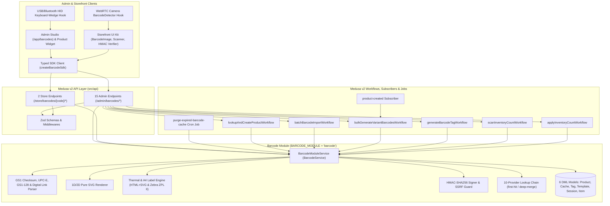

# medusa-plugin-barcode

**The Complete GS1 Barcode, Dynamic QR, Thermal/Sheet Label Printing, 10-Provider GTIN Product Lookup & Warehouse Inventory Stock-Take Suite for Medusa v2.**

`medusa-plugin-barcode` unifies and supersedes four separate Medusa ecosystem capabilities—external barcode product enrichment (`@bambiste/medusa-barcode`), dynamic QR & barcode generation (`@bambiste/medusa-qr`), POS/warehouse barcode scanning (`medusa-pos-plugin`), and physical stock-take auditing (`inventory-count`)—into one cohesive, zero-external-runtime-dependency **Medusa v2** plugin.

---

## Table of Contents

1. [Ecosystem Comparison & Why `medusa-plugin-barcode`](#1-ecosystem-comparison--why-medusa-plugin-barcode)
2. [Architecture Overview](#2-architecture-overview)
3. [Core Capabilities (The 4 Pillars)](#3-core-capabilities-the-4-pillars)
4. [Installation & Setup](#4-installation--setup)
5. [Full Configuration Reference](#5-full-configuration-reference)
6. [10-Provider GTIN & ISBN Lookup Chain](#6-10-provider-gtin--isbn-lookup-chain)
7. [GS1 Symbologies, Checksum Math & GS1-128 / Digital Link](#7-gs1-symbologies-checksum-math--gs1-128--digital-link)
8. [1D/2D SVG Barcode, Dynamic QR & Anti-Counterfeit HMAC Seals](#8-1d2d-svg-barcode-dynamic-qr--anti-counterfeit-hmac-seals)
9. [Thermal Roll & A4 Sheet Price/Barcode Label Printing (HTML + Zebra ZPL II)](#9-thermal-roll--a4-sheet-pricebarcode-label-printing-html--zebra-zpl-ii)
10. [Warehouse Stock-Take Count Sessions & Quick Scan Adjustments](#10-warehouse-stock-take-count-sessions--quick-scan-adjustments)
11. [Medusa v2 Workflows & Rollback Compensation](#11-medusa-v2-workflows--rollback-compensation)
12. [Subscribers & Scheduled Jobs](#12-subscribers--scheduled-jobs)
13. [Complete REST API Reference (Admin & Storefront)](#13-complete-rest-api-reference-admin--storefront)
14. [Typed SDK Client (`medusa-plugin-barcode/sdk`)](#14-typed-sdk-client-medusa-plugin-barcodesdk)
15. [React Hooks: USB HID Keyboard-Wedge & WebRTC Camera Scanners (`medusa-plugin-barcode/hooks`)](#15-react-hooks-usb-hid-keyboard-wedge--webrtc-camera-scanners-medusa-plugin-barcodehooks)
16. [Storefront UI Kit (`medusa-plugin-barcode/ui`)](#16-storefront-ui-kit-medusa-plugin-barcodeui)
17. [Admin Studio (`/app/barcodes`) & Product Detail Widget](#17-admin-studio-appbarcodes--product-detail-widget)
18. [Writing a Custom Lookup Provider](#18-writing-a-custom-lookup-provider)
19. [Migration Guide from `@bambiste/medusa-barcode` & `@bambiste/medusa-qr`](#19-migration-guide-from-bambistemedusa-barcode--bambistemedusa-qr)
20. [Security Architecture](#20-security-architecture)
21. [Testing, Linting & Typechecking](#21-testing-linting--typechecking)

---

## 1. Ecosystem Comparison & Why `medusa-plugin-barcode`

| Feature / Capability | `@bambiste/medusa-barcode` (`0.0.2`) | `@bambiste/medusa-qr` (`0.0.2`) | `medusa-pos-plugin` (`0.0.36`) | `inventory-count` (`0.0.6`) | `medusa-plugin-barcode` (`1.0.0`) |
| :--- | :---: | :---: | :---: | :---: | :---: |
| **Medusa Version** | v2 | v2 | v2 | v2 | **v2 (`>=2.4.0`)** |
| **GS1 Check Digit Validation** | Buggy left-to-right loop (fails on even-length `UPC-A`, `EAN-8`, `GTIN-14`) | N/A | None | None | **Spec-compliant right-to-left `3,1,3,1` GS1 Modulo-10** across all odd & even lengths |
| **Supported Symbologies** | `EAN-13`, `UPC-A`, `EAN-8`, `ISBN-13` | `QR` only | `barcode` string | `barcode` string | **`EAN-13`, `EAN-8`, `UPC-A`, `UPC-E`, `GTIN-14`, `ISBN-13`, `Code128`, `GS1-128`, `Code39`, `QR`, `DataMatrix`** |
| **GS1-128 AI & Digital Link** | No | No | No | No | **Full `(01)` GTIN, `(10)` Batch/Lot, `(11)`/`(15)`/`(17)` Dates, `(21)` Serial, `(30)`/`(37)` Qty, `(310n)` Net Weight + GS1 Digital Link URI** |
| **External GTIN Providers** | 8 providers (`first-hit` only) | None | None | None | **10 providers** (adds free keyless `OpenLibrary` & `Brocade`) + **`first-hit` & `deep-merge`** strategies + smart ISBN routing |
| **Batch Import Workflow** | Saves dummy `pending_${barcode}` rows without creating products | N/A | N/A | N/A | **Creates real Medusa Products & Variants** with transaction compensation/rollback |
| **Auto Variant Barcode Gen** | No | No | No | No | **GS1 In-Store (`200`–`299`) deterministic & sequential EAN-13 generator + `product.created` subscriber** |
| **1D/2D Barcode & QR Rendering** | None | QR PNG/SVG | None | None | **Zero-dependency crisp SVG renderer** for all 1D & 2D symbologies + optional File Module upload |
| **Anti-Counterfeit Verification** | None | None | None | None | **Constant-time `HMAC-SHA256` signed tags** + `/store/barcodes/[code]/verify` + `<AuthenticityVerifierBadge />` |
| **Thermal & Sheet Label Printing** | None | None | None | None | **7 built-in presets** (Thermal `50×25`, `57×32`, `100×50`, `30×15` Jewelry + A4 `24`/`40`/`65`-up), multi-currency MRP/Sale formatting, print-ready **HTML+SVG** & raw **Zebra ZPL II (`^XA...^XZ`)** |
| **Warehouse Stock-Take** | None | None | Basic POS scan | Separate plugin | **Built-in `BarcodeCountSession` & `BarcodeCountItem`** with live scan variance & 1-click Inventory Module reconciliation |
| **Admin UI & Scanners** | Empty 431-byte stub | Empty 431-byte stub | External POS | Basic | **5-Tab Admin Studio (`/app/barcodes`)**, Product Detail Widget (`product.details.after`), **USB HID Keyboard-Wedge** & **WebRTC Camera** hooks |

---

## 2. Architecture Overview



---

## 3. Core Capabilities (The 4 Pillars)

### Pillar 1: Multi-Provider GTIN/ISBN Lookup & Auto-Catalog Creation
- Queries **10 external barcode databases** (`OpenFoodFacts`, `OpenBeautyFacts`, `OpenPetFoodFacts`, `OpenProductsFacts`, `GoogleBooks`, `OpenLibrary`, `Brocade`, `UpcItemDb`, `EanSearch`, `BarcodeLookup`).
- **Automatic ISBN-13 (`978`/`979`) Priority Routing**: Promotes `GoogleBooks` and `OpenLibrary` to the front of the chain whenever a book barcode is scanned.
- **Configurable Enrichment Strategy**:
  - `"first-hit"`: Returns immediately on the highest-priority provider match for minimum latency.
  - `"deep-merge"`: Queries all active providers and merges missing fields (backfilling descriptions, ingredients, dimensions, suggested prices, and deduplicating image/category/author arrays).
- **Optional SSRF-Safe Image Downloading**: Downloads external product images (validating `https:` public hosts and 8 MB size cap) and uploads them directly to Medusa's File Module (`Modules.FILE`).

### Pillar 2: 1D/2D Barcode & Dynamic QR Generation + Anti-Counterfeit Seals
- **Pure SVG Rendering Engine**: Generates crisp, dependency-free vector SVGs for `EAN-13`, `ISBN-13`, `UPC-A`, `UPC-E`, `EAN-8`, `GTIN-14`, `Code128`, `GS1-128`, `Code39`, `QR`, and `DataMatrix`.
- **GS1 In-Store (`200`–`299`) Auto-Assignment**: Automatically generates valid 13-digit EAN-13 barcodes for new or existing Medusa product variants and syncs `barcode`, `ean`, and `upc` fields.
- **Dynamic `BarcodeTag` Tokens**: Supports `"view"`, `"add_to_cart"`, `"verify"` (anti-counterfeit), and `"gs1_digital_link"` scan actions with live `scan_count` and `last_scanned_at` analytics.
- **Constant-Time HMAC-SHA256 Verification**: Protects luxury, pharmaceutical, or limited-edition products against counterfeit tags using `crypto.timingSafeEqual`.

### Pillar 3: Thermal Roll & A4 Sheet Price/Barcode Label Printing Engine
- **7 Built-In Industry Presets + Custom Templates**:
  - Thermal Rolls: `thermal_50x25` (`50×25mm`), `thermal_57x32` (`57×32mm`), `thermal_100x50` (`100×50mm` Warehouse Carton), `jewelry_30x15` (`30×15mm` Dumbbell Tag).
  - A4 Laser/Inkjet Sheets: `a4_24up_70x37` (`3×8`), `a4_40up_52x30` (`4×10`), `a4_65up_38x21` (`5×13` Mini).
- **Multi-Currency Pricing**: Formats Sale Price and strike-through Compare-At / MRP Price via `Intl.NumberFormat`.
- **Dual Output Formats**:
  1. **Print-Ready HTML+SVG Document**: Exact millimeter `@page` CSS rules for browser/OS printing.
  2. **Raw Zebra ZPL II (`^XA...^XZ`)**: Native `203 DPI` / `300 DPI` commands (`^BEN`, `^B8N`, `^BCN`, `^BQN`, `^FO`, `^FD`, `^PQ`) for direct thermal printer streaming.

### Pillar 4: Admin Studio, Hardware/Camera Scanners & Warehouse Stock-Take
- **Admin Barcode Studio (`/app/barcodes`)**: 5-tab management center in Medusa Admin.
- **Product Detail Widget (`product.details.after`)**: Generate variant barcodes and print thermal labels directly on any product page.
- **Hardware & Camera Scanners**: `useHidBarcodeScanner` (USB/Bluetooth keyboard-wedge) and `useCameraBarcodeScanner` (WebRTC `BarcodeDetector`).
- **Warehouse Stock-Take Count Sessions**: Create `BarcodeCountSession` audits, scan items rapidly (`+1` / `-1` / `set`), inspect expected vs. counted variance, and apply adjustments directly to Medusa's Inventory Module (`Modules.INVENTORY`).

---

## 4. Installation & Setup

### Step 1: Install the Package

```bash
npm install medusa-plugin-barcode
# or
yarn add medusa-plugin-barcode
# or
pnpm add medusa-plugin-barcode
```

### Step 2: Register in `medusa-config.ts`

```ts
import { defineConfig } from "@medusajs/framework/utils"

export default defineConfig({
  projectConfig: {
    databaseUrl: process.env.DATABASE_URL,
  },
  plugins: [
    {
      resolve: "medusa-plugin-barcode",
      options: {
        cacheEnabled: true,
        cacheTtlSeconds: 86400,
        enrichmentStrategy: "deep-merge",
        autoGenerateVariantBarcode: true,
        internalBarcodePrefix: "200",
        defaultProductStatus: "draft",
        downloadProductImages: false,
        requestTimeoutMs: 5000,
        storefrontBaseUrl:
          process.env.STOREFRONT_URL || "https://store.example.com",
        hmacSecret: process.env.MEDUSA_BARCODE_HMAC_SECRET,
        providers: {
          openFoodFacts: { enabled: true, priority: 10 },
          googleBooks: {
            enabled: true,
            priority: 15,
            apiKey: process.env.GOOGLE_BOOKS_API_KEY,
          },
          openLibrary: { enabled: true, priority: 18 },
          openBeautyFacts: { enabled: true, priority: 20 },
          openPetFoodFacts: { enabled: true, priority: 25 },
          openProductsFacts: { enabled: true, priority: 30 },
          brocade: { enabled: true, priority: 35 },
          upcItemDb: {
            enabled: true,
            priority: 40,
            apiKey: process.env.UPCITEMDB_API_KEY,
          },
          eanSearch: {
            enabled: Boolean(process.env.EAN_SEARCH_TOKEN),
            priority: 60,
            apiKey: process.env.EAN_SEARCH_TOKEN,
          },
          barcodeLookup: {
            enabled: Boolean(process.env.BARCODE_LOOKUP_KEY),
            priority: 70,
            apiKey: process.env.BARCODE_LOOKUP_KEY,
          },
        },
      },
    },
  ],
})
```

### Step 3: Run Database Migrations

```bash
npx medusa db:migrate
```

---

## 5. Full Configuration Reference

| Option | Type | Default | Description |
| :--- | :--- | :--- | :--- |
| `cacheEnabled` | `boolean` | `true` | Caches external provider lookup responses in `barcode_cache`. |
| `cacheTtlSeconds` | `number` | `86400` (24h) | Time-to-live in seconds for cached lookup rows before expiration. |
| `enrichmentStrategy` | `"first-hit" \| "deep-merge"` | `"first-hit"` | `"first-hit"` stops at the first matching provider; `"deep-merge"` queries all active providers and merges non-null fields. |
| `autoGenerateVariantBarcode` | `boolean` | `true` | When `true`, the `product-created` subscriber auto-assigns a valid GS1 in-store EAN-13 barcode to newly created variants missing a barcode. |
| `internalBarcodePrefix` | `string` | `"200"` | 3-digit GS1 in-store prefix (`"200"`–`"299"`) used when generating internal EAN-13 barcodes. |
| `defaultProductStatus` | `"draft" \| "published"` | `"draft"` | Default Medusa product status when creating products from barcode lookups. |
| `downloadProductImages` | `boolean` | `false` | When `true`, downloads external provider images (SSRF-checked) and uploads them to Medusa's File Module (`Modules.FILE`). |
| `requestTimeoutMs` | `number` | `5000` | Per-provider HTTP timeout in milliseconds. |
| `storefrontBaseUrl` | `string` | `process.env.STOREFRONT_URL` | Base URL used when building storefront scan URLs and GS1 Digital Link URIs. |
| `hmacSecret` | `string` | `process.env.MEDUSA_BARCODE_HMAC_SECRET` | Secret key (minimum 16 chars) for signing and verifying anti-counterfeit `BarcodeTag` HMAC-SHA256 seals. |
| `providers.<name>` | `ProviderConfig` | See below | Per-provider configuration (`enabled`, `priority`, `timeout`, `apiKey`, `baseUrl`). |

---

## 6. 10-Provider GTIN & ISBN Lookup Chain

All 10 built-in providers implement `BaseBarcodeProvider` and normalize external responses into `NormalizedBarcodeProduct`:

| # | Provider Key | Class Name | Default Priority | API Key Required? | Domain / Specialty |
| :---: | :--- | :--- | :---: | :---: | :--- |
| 1 | `openfoodfacts` | `OpenFoodFactsProvider` | `10` | No (Free) | Global food, beverages, groceries, nutrition & ingredients |
| 2 | `googlebooks` | `GoogleBooksProvider` | `15` (Promoted `#1` on ISBN) | Optional | Books, magazines & media (`978`/`979` ISBN-13) |
| 3 | `openlibrary` | `OpenLibraryProvider` | `18` (Promoted `#2` on ISBN) | No (Free) | Internet Archive OpenLibrary ISBN & book covers |
| 4 | `openbeautyfacts` | `OpenBeautyFactsProvider` | `20` | No (Free) | Cosmetics, skincare, fragrances & personal care |
| 5 | `openpetfoodfacts` | `OpenPetFoodFactsProvider` | `25` | No (Free) | Pet food, treats & animal supplies |
| 6 | `openproductsfacts` | `OpenProductsFactsProvider` | `30` | No (Free) | Consumer electronics, household & general retail |
| 7 | `brocade` | `BrocadeProvider` | `35` | No (Free) | Open GTIN catalog (`brocade.io`) for general retail items |
| 8 | `upcitemdb` | `UpcItemDbProvider` | `40` | Optional (Free Trial / Paid Key) | General retail UPC/EAN catalog + lowest recorded price |
| 9 | `eansearch` | `EanSearchProvider` | `60` | Yes (`apiKey`) | Commercial global EAN/UPC/ISBN lookup (`ean-search.org`) |
| 10 | `barcodeLookup` | `BarcodeLookupProvider` | `70` | Yes (`apiKey`) | Commercial 700M+ product catalog (`barcodelookup.com`) |

---

## 7. GS1 Symbologies, Checksum Math & GS1-128 / Digital Link

### Right-to-Left GS1 Modulo-10 Check Digit Math
Per official GS1 specifications, the Modulo-10 check digit weights digits **`3, 1, 3, 1...` starting from the rightmost data digit** (immediately to the left of the check digit).
- Unlike `@bambiste/medusa-barcode` (which weighted left-to-right and failed on 8-, 12-, and 14-digit codes), `medusa-plugin-barcode` validates both odd-length (`EAN-13`, `ISBN-13`) and even-length (`UPC-A`, `UPC-E`, `EAN-8`, `GTIN-14`) barcodes accurately:

```ts
import {
  computeGs1CheckDigit,
  validateGs1Checksum,
  parseBarcode,
  parseGs1ApplicationIdentifiers,
  buildGs1DigitalLink,
} from "medusa-plugin-barcode"

validateGs1Checksum("3017620422003") // true (EAN-13)
validateGs1Checksum("012345678905")  // true (UPC-A, 12 digits)
validateGs1Checksum("96385074")      // true (EAN-8, 8 digits)
validateGs1Checksum("10614141000415") // true (GTIN-14, 14 digits)

// Parse GS1-128 Application Identifiers:
const gs1 = parseBarcode("(01)09506000134352(10)LOT2026(17)261231(21)SN9988(3102)001250")
// gs1.gs1 => {
//   gtin: "09506000134352",
//   batchLot: "LOT2026",
//   expiryDate: "2026-12-31",
//   serialNumber: "SN9988",
//   netWeightKg: 12.5,
//   rawAis: { "01": "09506000134352", "10": "LOT2026", "17": "261231", "21": "SN9988", "3102": "001250" }
// }

// Build a GS1 Digital Link URI:
const uri = buildGs1DigitalLink({
  baseUrl: "https://id.mybrand.com",
  gtin: "3017620422003",
  batchLot: "LOT-2026",
  serial: "SN-0042",
  expiry: "261231",
})
// => "https://id.mybrand.com/01/03017620422003/10/LOT-2026/21/SN-0042?17=261231"
```

---

## 8. 1D/2D SVG Barcode, Dynamic QR & Anti-Counterfeit HMAC Seals

### Rendering Standalone SVGs

```ts
import { renderBarcodeSvg } from "medusa-plugin-barcode"

const ean13Svg = renderBarcodeSvg({
  code: "3017620422003",
  symbology: "ean13",
  title: "Organic Hazelnut Spread",
  includeText: true,
})

const qrSvg = renderBarcodeSvg({
  code: "https://store.example.com/01/03017620422003/21/SN001",
  symbology: "qr",
  width: 200,
  height: 200,
})
```

### Creating & Verifying Anti-Counterfeit HMAC-SHA256 Tags

Each `BarcodeTag` automatically receives an `hmac_signature` computed over `code | targetId | serialNumber | batchLot` using `MEDUSA_BARCODE_HMAC_SECRET` and verified via `crypto.timingSafeEqual`:

```ts
// Create a signed anti-counterfeit QR tag via workflow:
const { result: tag } = await generateBarcodeTagWorkflow(req.scope).run({
  input: {
    target_type: "product",
    target_id: "prod_01HXYZ",
    product_id: "prod_01HXYZ",
    symbology: "qr",
    scan_action: "verify",
    gs1_gtin: "09506000134352",
    batch_lot: "BATCH-2026-09",
    serial_number: "SN-884920",
  },
})

// Verify authenticity on the storefront:
// GET /store/barcodes/mpb_AbCdEf12/verify?sig=<64-char-hex-hmac>
```

---

## 9. Thermal Roll & A4 Sheet Price/Barcode Label Printing (HTML + Zebra ZPL II)

### Built-In Label Presets (`BUILTIN_LABEL_TEMPLATES`)

| Preset ID | Layout Type | Dimensions (mm) | Grid (`cols × rows`) | Default Symbology | DPI | Typical Hardware / Use Case |
| :--- | :--- | :---: | :---: | :---: | :---: | :--- |
| `thermal_50x25` | `thermal_roll` | `50 × 25 mm` | `1 × 1` | `ean13` | `203` | Zebra ZD410 / ZD421 / Rollo retail price & barcode sticker |
| `thermal_57x32` | `thermal_roll` | `57 × 32 mm` | `1 × 1` | `ean13` | `203` | Dymo 30334 / Zebra apparel & shelf hang-tag with QR |
| `thermal_100x50` | `thermal_roll` | `100 × 50 mm` | `1 × 1` | `code128` | `203` | Warehouse master carton / bin label with QR |
| `jewelry_30x15` | `thermal_roll` | `30 × 15 mm` | `1 × 1` | `code128` | `300` | High-density 300 DPI jewelry / eyewear dumbbell tag |
| `a4_24up_70x37` | `a4_sheet` | `70 × 37 mm` | `3 × 8` (24/page) | `ean13` | `300` | Avery L7163 / standard A4 24-up laser/inkjet sheet |
| `a4_40up_52x30` | `a4_sheet` | `52.5 × 29.7 mm` | `4 × 10` (40/page) | `ean13` | `300` | Standard A4 40-up retail barcode sticker sheet |
| `a4_65up_38x21` | `a4_sheet` | `38.1 × 21.2 mm` | `5 × 13` (65/page) | `ean13` | `300` | Avery L7651 / A4 65-up mini price/EAN sticker sheet |

### Rendering Labels Programmatically

```ts
import { renderPrintableLabels } from "medusa-plugin-barcode"

const output = renderPrintableLabels(
  [
    {
      barcode: "3017620422003",
      title: "Organic Espresso Beans",
      variant_title: "250g Whole Bean",
      sku: "ESP-250-WB",
      brand: "Medusa Roasters",
      price: 14.5,
      compare_at_price: 18.0,
      currency_code: "USD",
      quantity: 2,
    },
  ],
  "thermal_50x25"
)

// output.html => Complete <!DOCTYPE html> document with @page CSS & inline SVGs
// output.zpl  => Raw Zebra ZPL II commands (^XA ... ^BEN ... ^XZ)
```

Example generated **Zebra ZPL II** output:

```zpl
^XA
^CI28
^PW400
^LL200
^LH0,0
^FO16,12^A0N,22,22^FDOrganic Espresso Beans^FS
^FO16,36^A0N,18,18^FD250g Whole Bean^FS
^FO16,56^A0N,16,16^FDSKU: ESP-250-WB^FS
^FO16,74^A0N,26,26^FD$14.50 (MRP $18.00)^FS
^FO16,104^BY2^BEN,68,Y,N^FD301762042200^FS
^PQ1,0,1,Y
^XZ
```

---

## 10. Warehouse Stock-Take Count Sessions & Quick Scan Adjustments

`medusa-plugin-barcode` supports two warehouse inventory scanning workflows:

1. **Instant Scan-to-Lookup / Quick Adjust (`POST /admin/barcodes/scan`)**:
   - Scan any barcode with a USB/Bluetooth HID scanner or camera to resolve its `product_id` and `variant_id`, and optionally trigger `"increment"`, `"decrement"`, or `"set"` actions.
2. **Full Stock-Take Audit Sessions (`BarcodeCountSession` & `BarcodeCountItem`)**:
   - Create a named count session scoped to a `location_id` with optional `expected_items`.
   - Rapidly scan items via `POST /admin/barcodes/count-sessions/[id]/scan` (`delta: 1`, `delta: -1`, or `set_quantity`).
   - Live calculation of `expected_quantity`, `counted_quantity`, and `variance` per item and across the session.
   - Reconcile and push counted quantities to Medusa's Inventory Module (`Modules.INVENTORY`) via `POST /admin/barcodes/count-sessions/[id]/apply`.

---

## 11. Medusa v2 Workflows & Rollback Compensation

All 6 workflows are exported from `medusa-plugin-barcode` and `medusa-plugin-barcode/workflows`:

| Workflow | Step / Workflow ID | Description & Rollback Behavior |
| :--- | :--- | :--- |
| `lookupAndCreateProductWorkflow` | `"lookup-and-create-product"` | Looks up a barcode across the provider chain, optionally uploads external images to `Modules.FILE`, creates a Medusa Product + Variant in `Modules.PRODUCT`, and links `BarcodeProduct`. **Compensates** by deleting both `BarcodeProduct` and the created Medusa Product on failure. |
| `batchBarcodeImportWorkflow` | `"batch-barcode-import"` | Batch-imports up to 100 barcodes, creating real Medusa Products + Variants and `BarcodeProduct` mappings. **Compensates** by rolling back all created products and mappings. |
| `bulkGenerateVariantBarcodesWorkflow` | `"bulk-generate-variant-barcodes"` | Generates GS1 in-store (`200`–`299`) EAN-13 barcodes for variants missing barcodes, updates `barcode`/`ean`/`upc` in `Modules.PRODUCT`, and creates `BarcodeTag` rows. **Compensates** by restoring previous variant barcode fields and deleting created tags. |
| `generateBarcodeTagWorkflow` | `"generate-barcode-tag"` | Creates/updates a dynamic 1D/2D `BarcodeTag` with SVG markup, HMAC-SHA256 signature, and optional `Modules.FILE` SVG upload. **Compensates** by deleting the created tag. |
| `scanInventoryCountWorkflow` | `"scan-inventory-count"` | Records a barcode scan inside an active `BarcodeCountSession` and updates item and session variance totals. |
| `applyInventoryCountWorkflow` | `"apply-inventory-count"` | Marks a `BarcodeCountSession` as `"completed"` and applies counted quantities to `Modules.INVENTORY`. **Compensates** by reverting the session status back to `"in_progress"`. |

---

## 12. Subscribers & Scheduled Jobs

- **Subscriber (`src/subscribers/product-created.ts`)**:
  - Listens to `product.created` and `product-variant.created`.
  - When `autoGenerateVariantBarcode !== false`, invokes `bulkGenerateVariantBarcodesWorkflow` so every new variant automatically receives a valid GS1 in-store EAN-13 barcode and `BarcodeTag`.
- **Scheduled Job (`src/jobs/purge-expired-barcode-cache.ts`)**:
  - Runs on cron schedule `0 */6 * * *` (every 6 hours) and purges expired rows from `barcode_cache`.

---

## 13. Complete REST API Reference (Admin & Storefront)

### Admin Endpoints

#### `GET /admin/barcodes`
Lists linked `BarcodeProduct` mappings (filterable by `?product_id=...`) and studio analytics overview.

#### `POST /admin/barcodes/lookup`
Looks up a barcode across the 10-provider chain without creating a product.
```json
{
  "barcode": "3017620422003",
  "strategy": "deep-merge",
  "skipCache": false
}
```

#### `POST /admin/barcodes/create-from-barcode`
Looks up a barcode and creates a Medusa Product + Variant via `lookupAndCreateProductWorkflow`.
```json
{
  "barcode": "3017620422003",
  "status": "draft",
  "strategy": "deep-merge",
  "downloadImages": false,
  "overridePrice": 6.99,
  "currencyCode": "USD"
}
```

#### `POST /admin/barcodes/batch`
Batch imports up to 100 barcodes via `batchBarcodeImportWorkflow`.
```json
{
  "barcodes": ["3017620422003", "9780140328721"],
  "status": "draft",
  "strategy": "first-hit",
  "createMissingAsDraft": true
}
```

#### `POST /admin/barcodes/bulk-generate`
Auto-generates GS1 in-store (`200`–`299`) EAN-13 barcodes for variants.
```json
{
  "variant_ids": ["variant_01HXYZ"],
  "prefix": "200",
  "overwrite": false
}
```

#### `POST /admin/barcodes/scan`
Resolves a barcode scan and performs an optional quick inventory action (`lookup`, `increment`, `decrement`, `set`).
```json
{
  "barcode": "3017620422003",
  "action": "increment",
  "quantity": 1,
  "location_id": "sloc_01"
}
```

#### `GET /admin/barcodes/cache` & `DELETE /admin/barcodes/cache`
Lists cached provider responses or purges expired entries (pass `?all=true` to clear all cache entries).

#### `GET /admin/barcodes/[barcode]` & `DELETE /admin/barcodes/[barcode]`
Retrieves a specific barcode's parsed metadata, `BarcodeProduct` link, `BarcodeTag`, and rendered SVG, or deletes its mapping and cache entry.

#### `GET /admin/barcodes/tags` & `POST /admin/barcodes/tags`
Lists `BarcodeTag` rows (filterable by `?product_id=...` or `?target_id=...`) or creates a signed 1D/2D `BarcodeTag`.

#### `GET /admin/barcodes/tags/[id]`, `PATCH /admin/barcodes/tags/[id]`, `DELETE /admin/barcodes/tags/[id]`
Retrieves, updates, or deletes a `BarcodeTag` by ID.

#### `GET /admin/barcodes/templates` & `POST /admin/barcodes/templates`
Lists all 7 built-in presets + custom database templates, or saves a new custom `BarcodeLabelTemplate`.

#### `POST /admin/barcodes/print`
Renders print-ready HTML+SVG sheets and raw Zebra ZPL II thermal commands.
```json
{
  "template_id": "thermal_50x25",
  "items": [
    {
      "barcode": "3017620422003",
      "title": "Organic Espresso Beans",
      "variant_title": "250g Whole Bean",
      "sku": "ESP-250-WB",
      "brand": "Medusa Roasters",
      "price": 14.5,
      "compare_at_price": 18.0,
      "currency_code": "USD",
      "quantity": 4
    }
  ]
}
```

#### `GET /admin/barcodes/count-sessions` & `POST /admin/barcodes/count-sessions`
Lists all warehouse stock-take sessions with their line items, or starts a new `BarcodeCountSession`.

#### `POST /admin/barcodes/count-sessions/[id]/scan`
Records a barcode scan (`delta` or `set_quantity`) inside an active count session.

#### `POST /admin/barcodes/count-sessions/[id]/apply`
Completes a stock-take session and pushes variances to Medusa's Inventory Module.

---

### Storefront Endpoints

#### `GET /store/barcodes/[code]`
- Default (`?format=json`): Resolves a scanned barcode or QR code, increments `scan_count`, and returns `{ code, parsed, found, action, target_url, product_id, variant_id, tag, barcode_product }`.
- Image mode (`?format=svg&symbology=ean13`): Returns `Content-Type: image/svg+xml` directly for ``.

#### `GET /store/barcodes/[code]/verify?sig=...` & `POST /store/barcodes/[code]/verify`
Verifies an anti-counterfeit `HMAC-SHA256` signature in constant time and returns `{ valid, code, reason, tag }`.

---

## 14. Typed SDK Client (`medusa-plugin-barcode/sdk`)

```ts
import { createBarcodeSdk } from "medusa-plugin-barcode/sdk"

const barcodeSdk = createBarcodeSdk({
  baseUrl: process.env.NEXT_PUBLIC_MEDUSA_BACKEND_URL || "http://localhost:9000",
  publishableApiKey: process.env.NEXT_PUBLIC_MEDUSA_PUBLISHABLE_KEY,
})

// Admin calls:
const lookup = await barcodeSdk.admin.lookup({
  barcode: "3017620422003",
  strategy: "deep-merge",
})
const labels = await barcodeSdk.admin.printLabels({
  template_id: "thermal_57x32",
  items: [{ barcode: "3017620422003", title: "Nutella 400g", price: 5.99, quantity: 2 }],
})

// Storefront calls:
const resolved = await barcodeSdk.store.resolveScan("3017620422003")
const verified = await barcodeSdk.store.verifyAuthenticity("MPB-001", hmacSignature)
const svgUrl = barcodeSdk.store.getSvgUrl("3017620422003", "ean13")
```

---

## 15. React Hooks: USB HID Keyboard-Wedge & WebRTC Camera Scanners (`medusa-plugin-barcode/hooks`)

```tsx
import {
  useHidBarcodeScanner,
  useCameraBarcodeScanner,
  useStoreBarcodeResolver,
} from "medusa-plugin-barcode/hooks"

export function WarehouseScannerView() {
  // 1. Hardware USB / Bluetooth HID Keyboard-Wedge Scanner (< 45ms keystroke intervals)
  const { lastScanned } = useHidBarcodeScanner({
    enabled: true,
    minLength: 6,
    maxInterKeyDelayMs: 45,
    onScan: (barcode) => {
      console.log("Hardware HID scanner read:", barcode)
    },
  })

  // 2. WebRTC Camera BarcodeDetector Scanner
  const { videoRef, isScanning, startCamera, stopCamera } =
    useCameraBarcodeScanner({
      facingMode: "environment",
      onScan: (barcode) => {
        console.log("Camera scanner read:", barcode)
      },
    })

  // 3. Storefront scan & HMAC authenticity resolver
  const { resolveScan, verifyAuthenticity } = useStoreBarcodeResolver()

  return (
    <div>
      <button onClick={() => (isScanning ? stopCamera() : void startCamera())}>
        {isScanning ? "Stop Camera" : "Start Camera"}
      </button>
      {isScanning && <video ref={videoRef} muted playsInline />}
      {lastScanned && <p>Last HID Scan: {lastScanned}</p>}
    </div>
  )
}
```

---

## 16. Storefront UI Kit (`medusa-plugin-barcode/ui`)

Drop-in React components with zero `dangerouslySetInnerHTML` usage:

```tsx
import {
  BarcodeImage,
  AuthenticityVerifierBadge,
  StorefrontBarcodeScanner,
} from "medusa-plugin-barcode/ui"

export function ProductPageBarcodeSection({ code, hmacSignature }: { code: string; hmacSignature: string }) {
  return (
    <div style={{ display: "grid", gap: 16 }}>
      {/* Crisp SVG Barcode or QR via safe data-URI / endpoint */}
      <BarcodeImage
        code={code}
        symbology="ean13"
        baseUrl="http://localhost:9000"
        width={220}
        height={88}
      />

      {/* Interactive Anti-Counterfeit HMAC Seal Verifier */}
      <AuthenticityVerifierBadge
        code={code}
        signature={hmacSignature}
        sdkOptions={{ baseUrl: "http://localhost:9000" }}
      />

      {/* Customer Camera + USB HID Scanner Modal/Card */}
      <StorefrontBarcodeScanner
        sdkOptions={{ baseUrl: "http://localhost:9000" }}
        onResolved={(res) => {
          if (res.target_url) window.location.href = String(res.target_url)
        }}
      />
    </div>
  )
}
```

---

## 17. Admin Studio (`/app/barcodes`) & Product Detail Widget

- **Admin Barcode Studio (`src/admin/routes/barcodes/page.tsx`)**:
  - Automatically mounts at `/app/barcodes` ("Barcode & Label Studio") with global USB HID scanner listener active across all 5 tabs:
    1. **GTIN Lookup & Batch Importer**: Live single lookup, 1-click Medusa product creation, and multi-line batch GTIN/ISBN importer.
    2. **Dynamic 1D/2D & HMAC QR Tags**: Create signed product/variant/order tags with GS1 GTIN, Batch/Lot, Serial Number, and scan action.
    3. **Thermal & Sheet Label Print Center**: Choose any of the 7 thermal/A4 presets, configure multi-currency MRP & Sale price, and export print-ready HTML+SVG or raw Zebra ZPL II (`^XA...^XZ`).
    4. **Warehouse Stock-Take**: Start count sessions, scan items (`+1` / `-1`), inspect variance, and apply counts to the Inventory Module.
    5. **Providers & Cache**: Inspect active lookup providers and purge expired/all cached lookups.
- **Product Detail Widget (`src/admin/widgets/product-barcode-widget.tsx`)**:
  - Injected into `product.details.after` on every Medusa Admin product page for 1-click GS1 EAN-13 generation and thermal label printing.

---

## 18. Writing a Custom Lookup Provider

You can register your own proprietary ERP, PIM, or regional GTIN database provider in `ProviderRegistry`:

```ts
import {
  BaseBarcodeProvider,
  type BarcodeSymbology,
  type NormalizedBarcodeProduct,
} from "medusa-plugin-barcode"

export class MyErpBarcodeProvider extends BaseBarcodeProvider {
  readonly name = "my_erp"

  constructor() {
    super({ priority: 5, timeout: 4000 })
  }

  async lookup(
    barcode: string,
    format: BarcodeSymbology
  ): Promise<NormalizedBarcodeProduct | null> {
    const data = await this.fetchJson<{ title?: string; brand?: string; price?: number }>(
      `https://erp.example.com/api/gtin/${encodeURIComponent(barcode)}`
    )
    if (!data?.title) return null

    return {
      barcode,
      barcode_type: format,
      name: data.title,
      description: null,
      brand: data.brand ?? null,
      manufacturer: data.brand ?? null,
      categories: ["ERP Catalog"],
      images: [],
      weight: null,
      weight_unit: null,
      dimensions: null,
      quantity_label: null,
      ingredients: null,
      nutrition: null,
      country_of_origin: null,
      suggested_price: data.price ?? null,
      currency_code: "USD",
      isbn: null,
      authors: [],
      publisher: null,
      published_date: null,
      page_count: null,
      provider: this.name,
      raw_data: data,
    }
  }
}

// Register at runtime:
const barcodeService = container.resolve("barcode")
const registry = await barcodeService.getProviderRegistry()
registry.register(new MyErpBarcodeProvider())
```

---

## 19. Migration Guide from `@bambiste/medusa-barcode` & `@bambiste/medusa-qr`

`medusa-plugin-barcode` maintains full export compatibility with `@bambiste/medusa-barcode`:
- `BARCODE_MODULE`, `BarcodeService` (alias for `BarcodeModuleService`), `BaseBarcodeProvider`, `ProviderRegistry`, all 8 original provider classes, `parseBarcode`, `computeEan13CheckDigit`, `upcToEan13`, `lookupAndCreateProductWorkflow`, and `batchBarcodeImportWorkflow` are all exported directly from the root package.
- Simply replace `@bambiste/medusa-barcode` and `@bambiste/medusa-qr` in `medusa-config.ts` with `medusa-plugin-barcode` and run `npx medusa db:migrate`.

---

## 20. Security Architecture

- **Zero DOM XSS (`escapeHtml` & Safe SVG Data-URIs)**: All product titles, SKUs, brands, and custom headers/footers interpolated into SVG or printable HTML sheets are escaped via `escapeHtml`. React components render SVGs via URL-encoded `data:image/svg+xml;utf8,...` `` elements—never `dangerouslySetInnerHTML` or `innerHTML`.
- **SSRF Prevention (`validateExternalImageUrl`)**: External image URLs returned by third-party barcode APIs are validated before fetching: only `https:` is permitted, and loopback/private/link-local addresses (`localhost`, `127.0.0.0/8`, `10.0.0.0/8`, `172.16.0.0/12`, `192.168.0.0/16`, `169.254.169.254` cloud metadata, IPv6 loopback/unique-local) are strictly blocked.
- **Constant-Time Anti-Counterfeit HMAC (`verifyAuthenticityHmac`)**: Uses `HMAC-SHA256` with `crypto.timingSafeEqual` to prevent timing side-channel signature forgery.
- **Strict Zod Input Validation (`src/api/validators.ts`)**: Every Admin and Store `POST`/`PATCH` endpoint enforces bounded string lengths, array sizes (e.g. max 100 batch barcodes, max 200 print items), and enum allowlists via `validateAndTransformBody`.

---

## 21. Testing, Linting & Typechecking

```bash
# Run TypeScript compiler typecheck (0 errors)
npm run typecheck

# Run strict @medusajs/eslint-plugin linter (--max-warnings=0)
npm run lint

# Run unit, provider, SVG/ZPL label printer, workflow compensation & security test suite
npm test
```
