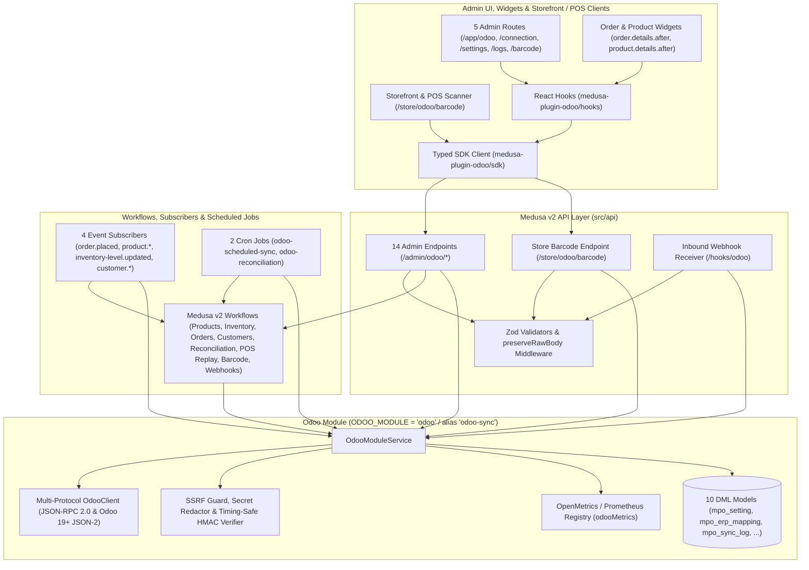

# `@vicacha-devs/medusa-plugin-odoo`

**The Complete Bidirectional Odoo ERP (Odoo 14–19+ JSON-RPC 2.0 & JSON-2 API) Integration, Multi-Warehouse Inventory Drift Reconciliation, Automated Order/Invoice/Payment Accounting, POS Barcode Resolver & Offline POS Replay Suite for Medusa v2 (`^2.21.0`).**

`medusa-plugin-odoo` unifies and supersedes two separate Medusa ecosystem packages—`@bambiste/medusa-odoo` and `@techmarbles/medusa-odoo-connector`—into a single self-contained, zero-external-SaaS-proxy **Medusa v2** plugin with native support for both legacy **Odoo 14–18 JSON-RPC 2.0** and modern **Odoo 19+ JSON-2 REST/RPC APIs**.

---

## Table of Contents

1. [Overview & Ecosystem Comparison](#1-overview--ecosystem-comparison)
2. [Architecture Overview](#2-architecture-overview)
3. [Installation & `medusa-config.ts` Configuration](#3-installation--medusa-configts-configuration)
4. [Bidirectional Sync Capabilities](#4-bidirectional-sync-capabilities)
5. [Database Schema (`mpo_*` Models)](#5-database-schema-mpo_-models)
6. [Medusa v2 Workflows & Compensation](#6-medusa-v2-workflows--compensation)
7. [Subscribers & Scheduled Jobs](#7-subscribers--scheduled-jobs)
8. [Complete REST API Reference](#8-complete-rest-api-reference)
9. [Typed SDK (`medusa-plugin-odoo/sdk`) & React Hooks (`medusa-plugin-odoo/hooks`)](#9-typed-sdk-medusa-plugin-odoosdk--react-hooks-medusa-plugin-odoohooks)
10. [Decoupled Admin UI, Widgets & 10-Locale i18n](#10-decoupled-admin-ui-widgets--10-locale-i18n)
11. [Security Architecture](#11-security-architecture)
12. [Development & Testing Commands](#12-development--testing-commands)

---

## 1. Overview & Ecosystem Comparison

| Feature / Capability | `@bambiste/medusa-odoo` | `@techmarbles/medusa-odoo-connector` | `@vicacha-devs/medusa-plugin-odoo` |
| :--- | :---: | :---: | :---: |
| **Medusa Version** | v2 (`^2.x`) | v2 (`^2.x`) | **v2 (`^2.21.0`)** |
| **External SaaS Proxy Required** | No | Yes (Requires external connector proxy) | **No (100% self-hosted inside Medusa)** |
| **Odoo Protocol Support** | JSON-RPC 2.0 only | Proxy-dependent | **Dual Protocol: JSON-RPC 2.0 (Odoo 14–18) & JSON-2 API (Odoo 19+)** |
| **Resilience & Rate Limiting** | Basic `fetch` | Proxy-dependent | **Token-Bucket Rate Limiter, Circuit Breaker (`closed`/`open`/`half-open`) & Exponential Backoff** |
| **Product & Variant Sync** | One-way import | Basic catalog sync | **Bidirectional (`odoo_to_medusa`, `medusa_to_odoo`, `bidirectional`) + non-destructive variant reconciliation** |
| **Multi-Warehouse Inventory** | Single stock location | Basic stock sync | **Multi-Warehouse `stock_location` ↔ `stock.warehouse` (`lot_stock_id`), `on_hand` & `forecasted` modes** |
| **Inventory Drift Reconciliation** | None | None | **Automated & manual drift detection (`odoo_wins`, `medusa_wins`, `manual_conflict`) + point-in-time snapshots** |
| **Orders, Invoices & Payments** | Basic `sale.order` | Basic `sale.order` | **Idempotent `sale.order` + `account.move` invoice creation/posting (`all`, `paid`, `fulfilled`) + `account.payment.register`** |
| **Two-Way Customer Sync** | Order partner only | Order partner only | **Two-way `res.partner` ↔ Medusa Customer sync with B2B Company/VAT & addresses** |
| **POS Barcode Resolver & Offline Replay** | None | None | **Sub-10ms `/store/odoo/barcode` resolver (`pos`, `warehouse`, `receiving`, `stocktake`) + Offline POS transaction queue** |
| **Inbound Webhooks & Observability** | None | Basic webhook | **Timing-safe HMAC-SHA256 `/hooks/odoo` with event deduplication + OpenMetrics/Prometheus `/admin/odoo/metrics`** |
| **Admin UI & i18n** | Minimal page | Settings form | **5-Route Admin Control Center (`/app/odoo/*`), Order & Product Widgets, 18 modular components (`< 170` lines), 10 locales** |

---

## 2. Architecture Overview



### Core Architectural Layers

1. **Multi-Protocol `OdooClient` (`src/modules/odoo/client/odoo-client.ts`)**:
   - **JSON-RPC 2.0 (`protocol: "jsonrpc"`)**: Authenticates via `/jsonrpc` (`service: "common"`, `method: "authenticate"`) and executes model methods via `service: "object"`, `method: "execute_kw"` for Odoo 14, 15, 16, 17, and 18.
   - **Odoo 19+ JSON-2 API (`protocol: "json2"`)**: Executes RESTful RPC calls against `/json/2/{model}/{method}` using `Authorization: Bearer <apiKey>` and optional `X-Odoo-Database: <db>`.
   - **Resilience Primitives**: Built-in token-bucket rate limiter (`rateLimitPerSec`), 3-state circuit breaker (`closed` → `open` → `half-open`), and exponential backoff retry loop (`maxRetries`).
2. **`OdooModuleService` (`src/modules/odoo/service.ts`)**:
   - Extends `MedusaService(OdooModels)` with full lifecycle management for connection settings, section configurations, bidirectional entity synchronization, drift reconciliation, barcode resolution, offline POS replay, and webhook processing.
3. **10 DML Models with `mpo_` Prefix (`src/modules/odoo/models/index.ts`)**:
   - Stores all ERP state in isolated PostgreSQL tables (`mpo_setting`, `mpo_erp_mapping`, `mpo_sync_log`, `mpo_sync_failure`, `mpo_inventory_snapshot`, `mpo_reconciliation_log`, `mpo_conflict_resolution`, `mpo_barcode_scan_log`, `mpo_offline_pos_transaction`, `mpo_webhook_event`).
4. **Compatibility Alias (`src/modules/odoo-sync/index.ts`)**:
   - Exposes `medusa-plugin-odoo/modules/odoo-sync` as a drop-in compatibility alias for projects migrating from `@bambiste/medusa-odoo`.

---

## 3. Installation & `medusa-config.ts` Configuration

### Step 1: Install the Package

```bash
pnpm add @vicacha-devs/medusa-plugin-odoo
# or
npm install @vicacha-devs/medusa-plugin-odoo
```

### Step 2: Configure `medusa-config.ts`

Register the plugin in `plugins` and the module in `modules` (using either `medusa-plugin-odoo/modules/odoo` or the compatibility alias `medusa-plugin-odoo/modules/odoo-sync`):

```ts
import { defineConfig } from "@medusajs/framework/utils"

export default defineConfig({
  projectConfig: {
    databaseUrl: process.env.DATABASE_URL,
  },
  plugins: [
    {
      resolve: "@vicacha-devs/medusa-plugin-odoo",
      options: {
        url: process.env.ODOO_URL,
        db: process.env.ODOO_DB,
        username: process.env.ODOO_USERNAME,
        apiKey: process.env.ODOO_API_KEY,
        password: process.env.ODOO_PASSWORD,
        protocol: "jsonrpc", // "jsonrpc" (Odoo 14–18) or "json2" (Odoo 19+)
        companyId: 1,
        timeoutMs: 30000,
        maxRetries: 3,
        rateLimitPerSec: 20,
        circuitThreshold: 5,
        circuitResetMs: 60000,
        allowPrivateNetwork: process.env.NODE_ENV !== "production",
        webhookSecret: process.env.ODOO_WEBHOOK_SECRET,
        productSettings: {
          enableProductSync: true,
          direction: "bidirectional",
          creationMode: "create_update",
          skuMapping: "sku",
          autoPublish: true,
          syncImages: true,
        },
        inventorySettings: {
          enableStock: true,
          direction: "bidirectional",
          qtyType: "on_hand",
          doNotSyncZeroStock: false,
        },
        orderSettings: {
          orderSync: true,
          confirmOrderInOdoo: true,
          exportInvoice: true,
          invoiceMode: "paid",
          markInvoicePaid: true,
          createPayment: true,
        },
        customerSettings: {
          enableCustomerSync: true,
          direction: "bidirectional",
          syncAddresses: true,
          syncCompanyVat: true,
        },
        reconciliationSettings: {
          enableScheduledReconciliation: true,
          strategy: "odoo_wins",
          driftThreshold: 0,
        },
      },
    },
  ],
  modules: [
    {
      resolve: "@vicacha-devs/medusa-plugin-odoo/modules/odoo",
      // Compatibility alias also supported:
      // resolve: "@vicacha-devs/medusa-plugin-odoo/modules/odoo-sync",
      options: {
        url: process.env.ODOO_URL,
        db: process.env.ODOO_DB,
        username: process.env.ODOO_USERNAME,
        apiKey: process.env.ODOO_API_KEY,
        protocol: "jsonrpc",
      },
    },
  ],
})
```

### Step 3: Run Database Migrations

```bash
npx medusa db:migrate
```

---

## 4. Bidirectional Sync Capabilities

### 4.1 Products & Variants (`product.template` ↔ `product` & `product.product` ↔ `variant`)
- **Odoo → Medusa Import**: Fetches `product.template` and `product.product` records, maps attributes to Medusa options/variants, converts `image_1920` base64 images into data URLs or file attachments, deduplicates product handles via `slugifyHandle`, and performs **non-destructive variant reconciliation** (matching existing variants by `ErpMapping`, `sku`, or `barcode` without destroying historical IDs).
- **Medusa → Odoo Export**: Pushes Medusa products and variants to Odoo `product.template` / `product.product`, computes SHA-256 payload checksums (`computeExternalChecksum`), and updates `mpo_erp_mapping` to prevent circular subscriber loops.

### 4.2 Multi-Warehouse Inventory & Drift Reconciliation (`stock.quant` / `stock.warehouse`)
- **Location Mapping**: Maps Medusa `stock_location` IDs to Odoo `stock.warehouse` (`lot_stock_id`) records.
- **Quantity Modes**: Supports both **On-Hand (`quantity` / `qty_available`)** and **Forecasted (`virtual_available`)** inventory quantities.
- **Automated Drift Reconciliation**: Compares Medusa inventory levels against Odoo stock quants across all mapped variants and warehouses, recording point-in-time `mpo_inventory_snapshot` rows and resolving discrepancies using:
  - `odoo_wins`: Automatically updates Medusa inventory levels to match Odoo.
  - `medusa_wins`: Automatically writes Odoo `stock.quant` inventory adjustments to match Medusa.
  - `manual_conflict`: Opens an `mpo_conflict_resolution` record for human review in `/app/odoo/logs`.

### 4.3 Orders, Invoices & Payments (`sale.order`, `account.move`, `account.payment.register`)
- **Order Sync**: Triggered automatically on `order.placed` or manually from the Order widget / API. Resolves or creates the customer `res.partner`, maps line items by SKU/ERP mapping, creates `sale.order` + `sale.order.line`, and optionally confirms the quotation (`action_confirm`).
- **Invoicing & Payment Registration**: When `exportInvoice` is enabled and the order satisfies `invoiceMode` (`all`, `paid`, or `fulfilled`), creates and posts the Odoo invoice (`account.move` / `action_post`) and optionally registers payment via `account.payment.register` against the configured `paymentJournalId`.

### 4.4 Customers (`res.partner`)
- **Two-Way Partner Sync**: Matches Medusa customers and Odoo `res.partner` records via `mpo_erp_mapping` and normalized email addresses, syncing names, phone numbers, street/city/zip/country addresses, and B2B company/VAT fields.

### 4.5 POS & Warehouse Barcode Resolver + Offline POS Replay
- **Sub-10ms Barcode Lookup (`POST /store/odoo/barcode`)**: Resolves `barcode`, `EAN-13`, `UPC`, or `SKU` across four operational contexts (`pos`, `warehouse`, `receiving`, `stocktake`) using an in-memory TTL cache → `mpo_erp_mapping` → Medusa database → live Odoo RPC fallback, logging every scan to `mpo_barcode_scan_log`.
- **Offline POS Transaction Queue (`mpo_offline_pos_transaction`)**: Enqueues offline POS checkouts with idempotent `external_transaction_id` deduplication and replays them into Medusa orders and Odoo `sale.order` records once connectivity is restored.

### 4.6 Inbound Webhooks (`/hooks/odoo`) & Prometheus Metrics (`/admin/odoo/metrics`)
- **Inbound Webhooks**: Verifies `x-odoo-signature` / `x-webhook-signature` against the raw request body using `crypto.timingSafeEqual`, deduplicates events by `event_id` in `mpo_webhook_event`, and dispatches real-time product, stock, customer, or order updates.
- **Prometheus Metrics**: Exposes counters and gauges (`odoo_sync_runs_total`, `odoo_sync_records_processed_total`, `odoo_sync_duration_ms_sum`, `odoo_rpc_requests_total`, `odoo_barcode_lookups_total`, `odoo_circuit_breaker_state`, `odoo_open_failures_total`, `odoo_open_conflicts_total`) in both JSON and OpenMetrics text format (`GET /admin/odoo/metrics?format=prometheus`).

---

## 5. Database Schema (`mpo_*` Models)

All 10 DML models are defined in `src/modules/odoo/models/index.ts` and created by `src/modules/odoo/migrations/Migration20260412000000.ts`:

| Model Export | Table Name | Primary Purpose & Key Columns |
| :--- | :--- | :--- |
| `OdooSetting` | `mpo_setting` | Key-value JSON configuration store (`key` unique index, `value` JSONB) for connection credentials and per-section settings (`product`, `inventory`, `orders`, `customers`, `reconciliation`, `webhooks`, `pos`). |
| `ErpMapping` | `mpo_erp_mapping` | Cross-system entity link table (`entity_type`, `medusa_id`, `odoo_id`, `odoo_model`, `sync_direction`, `external_checksum`, `status`, `last_synced_at`, `metadata`). |
| `ErpSyncLog` | `mpo_sync_log` | Execution audit log for sync runs (`entity_type`, `direction`, `trigger`, `status`, `created_count`, `updated_count`, `skipped_count`, `failed_count`, `duration_ms`, `message`, `error_details`). |
| `ErpSyncFailure` | `mpo_sync_failure` | Dead-letter queue for failed entity sync operations (`entity_type`, `medusa_id`, `odoo_id`, `direction`, `trigger`, `payload`, `error_message`, `attempt_count`, `resolved`, `resolved_at`, `resolved_by`). |
| `ErpInventorySnapshot` | `mpo_inventory_snapshot` | Point-in-time stock comparison records (`product_id`, `variant_id`, `sku`, `location_id`, `odoo_product_id`, `odoo_location_id`, `quantity_medusa`, `quantity_odoo`, `delta`, `reconciled`, `resolution_action`, `snapshot_at`). |
| `ErpReconciliationLog` | `mpo_reconciliation_log` | Summary log for inventory drift reconciliation runs (`reconciliation_type`, `strategy`, `drift_threshold`, `triggered_by`, `status`, `checked_count`, `matched_count`, `drifted_count`, `fixed_count`, `conflict_count`, `error_count`, `details`). |
| `ErpConflictResolution` | `mpo_conflict_resolution` | Manual review queue for stock or field conflicts (`entity_type`, `medusa_id`, `odoo_id`, `field_name`, `medusa_value`, `odoo_value`, `strategy`, `status`, `resolved_value`, `resolved_by`, `resolved_at`). |
| `BarcodeScanLog` | `mpo_barcode_scan_log` | Telemetry log for POS & warehouse barcode scans (`barcode`, `context`, `variant_id`, `odoo_product_id`, `source`, `resolution_status`, `latency_ms`, `scan_timestamp`). |
| `OfflinePosTransaction` | `mpo_offline_pos_transaction` | Durable queue for offline POS orders (`external_transaction_id` unique index, `customer_id`, `customer_email`, `currency`, `total_cents`, `discount_cents`, `items`, `status`, `medusa_order_id`, `odoo_order_id`, `replay_attempt_count`, `replay_error`). |
| `OdooWebhookEvent` | `mpo_webhook_event` | Idempotency ledger for inbound Odoo webhooks (`event_id` unique index, `event_type`, `odoo_model`, `odoo_record_id`, `status`, `payload`, `error_message`, `processed_at`). |

---

## 6. Medusa v2 Workflows & Compensation

Defined in `src/workflows/index.ts` and orchestrated with `OdooModuleService`:

| Workflow / Operation | Workflow ID / Service Method | Step(s) | Trigger & Compensation Behavior |
| :--- | :--- | :--- | :--- |
| **`syncProductsWithOdooWorkflow`** | `sync-products-with-odoo` | `sync-products` (`syncProductsStep`) | Triggered via `POST /admin/odoo/sync/products`, `product-updated` subscriber, or scheduled cron. Records `logId` in `StepResponse` and logs per-item failures to `mpo_sync_failure`. |
| **`syncInventoryWithOdooWorkflow`** | `sync-inventory-with-odoo` | `sync-inventory` (`syncInventoryStep`) | Triggered via `POST /admin/odoo/sync/inventory`, `inventory-updated` subscriber, or scheduled cron. Syncs multi-warehouse stock and returns `StepResponse(res, { logId })`. |
| **`syncOrderToOdooWorkflow`** | `sync-order-to-odoo` | `sync-order` (`syncOrderStep` → `executeOrderSyncToOdoo`) | Triggered via `order.placed` subscriber or `POST /admin/odoo/sync-order/:id`. Queries order graph, creates/updates Odoo `sale.order` + optional `account.move` invoice & payment, and writes `odoo_order_id` / `odoo_invoice_id` back to order metadata. |
| **`syncCustomersWithOdooWorkflow`** (`syncCustomerWithOdooWorkflow`) | `sync-customers-with-odoo` | `sync-customers` (`syncCustomersStep`) | Triggered via `POST /admin/odoo/sync/customers`, `customer-updated` subscriber, or scheduled cron. Syncs Medusa customers ↔ Odoo `res.partner`. |
| **`reconcileOdooInventoryWorkflow`** (`reconcileInventoryDriftWorkflow`) | `reconcile-odoo-inventory` | `reconcile-inventory` (`reconcileInventoryStep`) | Triggered via `POST /admin/odoo/sync/reconciliation` or `odoo-reconciliation` cron job. Captures `mpo_inventory_snapshot` rows and applies `odoo_wins`, `medusa_wins`, or `manual_conflict`. |
| **`replayOfflinePosTransactionWorkflow`** (`replayOfflinePosTransactionsWorkflow`) | `replay-offline-pos-transaction` | `replay-pos-transaction` (`replayPosTransactionStep`) | Triggered via `POST /admin/odoo/pos-transactions` (`action: "replay"`). Replays queued offline POS transactions into Medusa and Odoo idempotently. |
| **Barcode Scan Resolution (`resolveBarcodeScanWorkflow` / `odooService.resolveBarcode`)** | `odooService.resolveBarcode` | Cache → `ErpMapping` → Medusa DB → Odoo RPC | Triggered via `POST /store/odoo/barcode`. Resolves barcode in `pos`, `warehouse`, `receiving`, or `stocktake` context and records `mpo_barcode_scan_log`. |
| **Inbound Webhook Processing (`processOdooWebhookWorkflow` / `odooService.processWebhookEvent`)** | `odooService.processWebhookEvent` | HMAC Verify → Deduplicate `event_id` → Dispatch Sync | Triggered via `POST /hooks/odoo`. Validates HMAC-SHA256 signature, records `mpo_webhook_event`, and updates mapped entities. |

---

## 7. Subscribers & Scheduled Jobs

### Event Subscribers (`src/subscribers/`)

| File | Subscriber ID | Events Listened To | Behavior & Loop Prevention |
| :--- | :--- | :--- | :--- |
| `order-placed.ts` | `odoo-order-placed-subscriber` | `order.placed` | Invokes `executeOrderSyncToOdoo(container, { orderId, manual: false })` to create the Odoo `sale.order`, invoice, and payment when `orderSync` is enabled. |
| `product-updated.ts` | `odoo-product-updated-subscriber` | `product.created`, `product.updated` | Checks `product` section settings (`enableProductSync` and `direction` in `medusa_to_odoo` / `bidirectional`) and exports updated products using SHA-256 checksum comparison (`external_checksum`) to prevent infinite sync loops. |
| `inventory-updated.ts` | `odoo-inventory-updated-subscriber` | `inventory-level.updated` | Checks `inventory` section settings (`enableStock` and `direction` in `medusa_to_odoo` / `bidirectional`) and exports stock deltas to Odoo warehouses. |
| `customer-updated.ts` | `odoo-customer-updated-subscriber` | `customer.created`, `customer.updated` | Checks `customers` section settings (`enableCustomerSync` and `direction` in `medusa_to_odoo` / `bidirectional`) and syncs customer changes to `res.partner`. |

### Scheduled Jobs (`src/jobs/`)

| File | Job Name | Cron Schedule | Description |
| :--- | :--- | :--- | :--- |
| `odoo-scheduled-sync.ts` | `odoo-scheduled-sync-job` | `*/15 * * * *` (configurable; e.g. `0 */6 * * *`) | Verifies connection credentials are configured, then sequentially runs `syncProducts`, `syncInventory`, and `syncCustomers` with `trigger: "scheduled"`. |
| `odoo-reconciliation.ts` | `odoo-inventory-reconciliation-job` | `0 */6 * * *` (configurable; e.g. `0 2 * * *`) | Verifies connection credentials and `reconciliation.enableScheduledReconciliation !== false`, then executes `reconcileInventory({ triggeredBy: "scheduled" })`. |

---

## 8. Complete REST API Reference

### Admin Endpoints (`/admin/odoo/*`)

| Method | Path | Validator Schema | Description |
| :--- | :--- | :--- | :--- |
| `GET` | `/admin/odoo/status` | — | Returns connection status (`connected`, `disconnected`, `unconfigured`), active protocol, circuit breaker state, Odoo server version, and entity counters. |
| `GET` | `/admin/odoo/config` | — | Returns the current connection configuration with secrets (`password`, `apiKey`, `webhookSecret`) masked via `redactOdooConfig`. |
| `POST` | `/admin/odoo/config` | `OdooConfigSchema` | Validates URL safety (`validateSafeOdooUrl`), preserves existing secrets when omitted, and saves connection settings to `mpo_setting`. |
| `POST` | `/admin/odoo/verify-connection` | `OdooVerifyConnectionSchema` | Tests live connectivity against Odoo and returns `uid`, `serverVersion`, `companies`, `warehouses`, `journals`, and `categories`. |
| `GET` | `/admin/odoo/sections/:section` | — | Reads section settings for `product`, `inventory`, `orders`, `customers`, `reconciliation`, `webhooks`, or `pos`. |
| `POST` | `/admin/odoo/sections/:section` | — | Merges and persists partial settings for the specified `:section`. |
| `GET` | `/admin/odoo/options` | — | Fetches Medusa `stockLocations`, `collections`, and `salesChannels` alongside Odoo `companies`, `warehouses`, `journals`, and `categories`. |
| `POST` | `/admin/odoo/sync/:entity` | `OdooTriggerSyncSchema` | Triggers manual sync for `products`, `inventory`, `customers`, `reconciliation`, or `all`. |
| `POST` | `/admin/odoo/sync-order/:id` | — | Manually syncs a specific Medusa order ID to Odoo `sale.order` (with optional invoice and payment). |
| `GET` | `/admin/odoo/mappings` | — | Lists `mpo_erp_mapping` rows filtered by optional `entity_type` and `medusa_id`. |
| `POST` | `/admin/odoo/mappings` | `OdooUpsertMappingSchema` | Creates or updates an explicit `ErpMapping` link between a Medusa ID and an Odoo ID. |
| `GET` | `/admin/odoo/logs` | — | Returns recent `mpo_sync_log` runs, `mpo_reconciliation_log` runs, and `mpo_inventory_snapshot` records. |
| `GET` | `/admin/odoo/failures` | — | Lists dead-letter `mpo_sync_failure` records filtered by `resolved`. |
| `POST` | `/admin/odoo/failures` | `OdooResolveFailureSchema` | Marks a dead-letter `mpo_sync_failure` record as resolved. |
| `GET` | `/admin/odoo/conflicts` | — | Lists `mpo_conflict_resolution` records filtered by `status` (`open` / `resolved`). |
| `POST` | `/admin/odoo/conflicts` | `OdooResolveConflictSchema` | Resolves an inventory drift conflict using `odoo_wins`, `medusa_wins`, or `custom`. |
| `GET` | `/admin/odoo/pos-transactions` | — | Lists offline POS transactions (`mpo_offline_pos_transaction`). |
| `POST` | `/admin/odoo/pos-transactions` | `OdooPosTransactionActionSchema` | Enqueues (`action: "enqueue"`) or replays (`action: "replay"`) an offline POS transaction. |
| `GET` | `/admin/odoo/metrics` | — | Returns Prometheus text exposition when `?format=prometheus` is passed, or JSON metrics plus Prometheus string otherwise. |

### Store & Webhook Endpoints

| Method | Path | Validator Schema | Description |
| :--- | :--- | :--- | :--- |
| `POST` | `/store/odoo/barcode` | `OdooBarcodeLookupSchema` | Resolves a scanned barcode/EAN-13/SKU for `pos`, `warehouse`, `receiving`, or `stocktake` context. Returns `200` when found or `404` when unmatched. |
| `POST` | `/hooks/odoo` | `OdooWebhookBodySchema` (`preserveRawBody: true`) | Verifies `x-odoo-signature` / `x-webhook-signature` via HMAC-SHA256, deduplicates `event_id`, and processes inbound Odoo events. |

---

## 9. Typed SDK (`medusa-plugin-odoo/sdk`) & React Hooks (`medusa-plugin-odoo/hooks`)

### Typed SDK Usage

```ts
import { createOdooSdk, defaultOdooSdk, odooQueryKeys } from "@vicacha-devs/medusa-plugin-odoo/sdk"

const odooSdk = createOdooSdk({
  baseUrl: process.env.MEDUSA_BACKEND_URL,
})

// Admin operations
const status = await odooSdk.admin.getStatus()
const syncRes = await odooSdk.admin.triggerSync("products", {
  direction: "bidirectional",
})

// Storefront / POS barcode resolution
const scan = await odooSdk.store.lookupBarcode({
  barcode: "4006381333931",
  context: "pos",
})
```

### React Hooks Usage

All hooks are exported from `@vicacha-devs/medusa-plugin-odoo/hooks` and built on lightweight, zero-boilerplate query/mutation primitives (`useOdooQuery`, `useOdooMutation`) with automatic cache invalidation:

- **Query Hooks**: `useOdooStatus`, `useOdooConfig`, `useOdooSectionSettings`, `useOdooOptions`, `useOdooMappings`, `useOdooSyncLogs`, `useOdooFailures`, `useOdooConflicts`, `useOdooPosTransactions`.
- **Mutation Hooks**: `useSaveOdooConfig`, `useVerifyOdooConnection`, `useSaveOdooSectionSettings`, `useTriggerOdooSync`, `useSyncOrderToOdoo`, `useResolveOdooFailure`, `useResolveOdooConflict`, `useBarcodeLookup`.

---

## 10. Decoupled Admin UI, Widgets & 10-Locale i18n

### 5 Admin Routes (`src/admin/routes/odoo/`)
- **`/app/odoo` (`src/admin/routes/odoo/page.tsx`)**: Main overview dashboard featuring `OdooHeader`, 4 KPI `StatCard`s, a 2×2 `NavigationCard` grid linking to sub-routes, and `OverviewTab` manual bidirectional sync controls.
- **`/app/odoo/connection` (`src/admin/routes/odoo/connection/page.tsx`)**: Two-column layout with `ConnectionTab` (`KeyboundForm` credentials, protocol selector, private-network toggle) in `main` and `ConnectionSecuritySideSection` in `side`.
- **`/app/odoo/settings` (`src/admin/routes/odoo/settings/page.tsx`)**: Two-column layout with `ProductSyncSettingsSection` & `OrderSyncSettingsSection` in `main`, and `InventorySyncSettingsSection` & `ReconciliationSettingsSection` in `side`.
- **`/app/odoo/logs` (`src/admin/routes/odoo/logs/page.tsx`)**: Single-column observability view rendering `SyncFailuresSection`, `DriftConflictsSection`, and `RecentSyncRunsSection`.
- **`/app/odoo/barcode` (`src/admin/routes/odoo/barcode/page.tsx`)**: Two-column POS & warehouse tool pairing `BarcodeLookupSection` with `PosTransactionsSection`.

### 2 Admin Detail Widgets (`src/admin/widgets/`)
- **`order-odoo-widget.tsx` (`order.details.after`)**: Displays `OrderOdooSummary` with Odoo `sale.order` and `account.move` invoice badges plus one-click manual order sync / re-verification.
- **`product-odoo-widget.tsx` (`product.details.after`)**: Displays the linked Odoo `product.template` ID badge and one-click catalog sync button.

### 18 Modular Components (`< 170` lines each) & 10-Locale i18n
- Every component under `src/admin/components/` is strictly under 170 lines and uses `@medusajs/ui` primitives (`Container`, `Heading`, `Text`, `StatusBadge`, `Badge`, `Button`, `Table`, `Input`, `Select`, `Switch`, `Skeleton`, `Toaster`).
- Full 10-locale Admin internationalization (`en`, `es`, `fr`, `de`, `it`, `pt`, `nl`, `pl`, `tr`, and `ar` with RTL support) under `src/admin/i18n/`.

---

## 11. Security Architecture

Implemented in `src/modules/odoo/utils/security.ts`:

1. **SSRF Protection (`validateSafeOdooUrl`)**:
   - Enforces `http:` or `https:` protocols only.
   - Rejects URLs with embedded `username` or `password` credentials.
   - Blocks cloud metadata endpoints (`169.254.169.254`, `metadata.google.internal`, `metadata.goog`, `100.100.100.200`, `fd00:ec2::254`, `169.254.*`).
   - Blocks loopback and private RFC1918/RFC6598/IPv6 ULA ranges (`localhost`, `*.local`, `*.internal`, `127.0.0.0/8`, `10.0.0.0/8`, `172.16.0.0/12`, `192.168.0.0/16`, `100.64.0.0/10`, `::1`, `fe80::`, `fc00::/7`) unless `allowPrivateNetwork: true` is explicitly enabled for local development.
2. **Credential Redaction (`redactOdooConfig` & `redactSecret`)**:
   - Masks `password`, `apiKey`, and `webhookSecret` (`ab****yz` or `******`) before returning configuration objects from `/admin/odoo/config` while providing boolean `hasPassword`, `hasApiKey`, and `hasWebhookSecret` indicators.
3. **Timing-Safe Webhook Verification (`verifyOdooWebhookSignature`)**:
   - Computes `HMAC-SHA256` over the unparsed `rawBody` buffer (`preserveRawBody: true` in `src/api/middlewares.ts`) and compares hex digests using `crypto.timingSafeEqual`.
4. **Rate Limiting & Circuit Breaker (`OdooClient`)**:
   - Token-bucket throttling (`rateLimitPerSec`) prevents overwhelming Odoo worker processes, while the circuit breaker trips to `open` after `circuitThreshold` consecutive failures and probes recovery in `half-open` after `circuitResetMs`.

---

## 12. Development & Testing Commands

```bash
# Typecheck all backend and Admin UI TypeScript files
npm run typecheck

# Run the full test suite (Node native test runner + TypeScript resolver)
npm test

# Build the Medusa plugin bundle (.medusa/server)
npm run build

# Start plugin development watch mode
npm run dev
```
