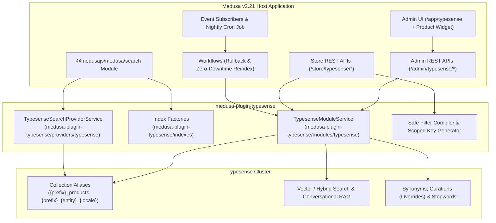

# medusa-plugin-typesense

A full-featured **Typesense Search, Vector/Hybrid AI Discovery, Merchandising, and Custom Entity Indexing Plugin for Medusa v2 (`^2.21.0`)**.

Built specifically for **Medusa `2.21+`** with a **Dual Architecture**:
1. **Standalone Typesense Module, Workflows, Subscribers, REST APIs & Admin UI (`/app/typesense`)**: Zero-downtime collection alias rebuilds, Multi-way & One-way Synonyms, Curations/Overrides (pinning, hiding, promo banners, scheduled windows), Stopwords, Vector/Hybrid search, Conversational RAG, Search Analytics, Custom Entities indexing, and Hydrated Storefront APIs.
2. **Native Medusa `2.21` Search Module Provider (`medusa-plugin-typesense/providers/typesense`) & Index Factories (`medusa-plugin-typesense/indexes`)**: Plugs directly into `@medusajs/medusa/search` with `defineProductSearchIndex`, `defineCategorySearchIndex`, `defineCollectionSearchIndex`, and `defineCustomSearchIndex`.

---

## Table of Contents

- [Features](#features)
- [Compatibility](#compatibility)
- [Architecture](#architecture)
- [Installation](#installation)
- [Configuration (`medusa-config.ts`)](#configuration-medusa-configts)
  - [Environment Variables (`.env`)](#environment-variables-env)
  - [Full Configuration Reference](#full-configuration-reference)
- [Medusa 2.21 Native Search Index Factories (`src/search/`)](#medusa-221-native-search-index-factories-srcsearch)
- [Built-In Schemas & Custom Entities](#built-in-schemas--custom-entities)
  - [Built-In Entities (`products`, `categories`, `collections`)](#built-in-entities-products-categories-collections)
  - [Indexing Custom Entities (`brands`, `vendors`, `reviews`, etc.)](#indexing-custom-entities-brands-vendors-reviews-etc)
- [Vector, Semantic & Hybrid AI Search](#vector-semantic--hybrid-ai-search)
- [Multi-Language & Localization](#multi-language--localization)
- [Merchandising: Synonyms, Curations & Stopwords](#merchandising-synonyms-curations--stopwords)
- [Storefront API Reference (`/store/typesense/*`)](#storefront-api-reference-storetypesense)
  - [Hydrated Product Search (`GET / POST /store/typesense/products`)](#1-hydrated-product-search-get--post-storetypesenseproducts)
  - [Hydrated Category & Collection Search](#2-hydrated-category--collection-search)
  - [Federated Multi-Entity Search (`POST /store/typesense/search`)](#3-federated-multi-entity-search-post-storetypesensesearch)
  - [Structured Filter DSL](#4-structured-filter-dsl)
  - [Scoped InstantSearch Key (`GET /store/typesense/token`)](#5-scoped-instantsearch-key-get-storetypesensetoken)
  - [Conversational RAG Search (`POST /store/typesense/chat`)](#6-conversational-rag-search-post-storetypesensechat)
  - [Search Analytics Tracking (`POST /store/typesense/analytics`)](#7-search-analytics-tracking-post-storetypesenseanalytics)
- [Admin API Reference (`/admin/typesense/*`)](#admin-api-reference-admintypesense)
- [Admin UI Dashboard & Product Widget](#admin-ui-dashboard--product-widget)
- [Workflows & Programmatic Usage](#workflows--programmatic-usage)
- [Security & Multi-Tenant Guarantees](#security--multi-tenant-guarantees)
- [Development & Testing](#development--testing)
- [License](#license)

---

## Features

- **Typo-Tolerant Full-Text Search** — Prefix matching, configurable field weights (`query_by_weights`), custom token separators (`-`, `_`, `/`), highlighting (`<mark>`), snippets, and result grouping (`group_by`).
- **Faceted & Disjunctive Search** — Value facets, numeric range facets (`min_price`), statistical facets (`min`, `max`, `avg`, `sum`), and automatic **disjunctive faceting** batched into a single Typesense `multi_search` request.
- **Vector, Semantic & Hybrid AI Search** — Supports Typesense built-in local ONNX models (`ts/all-MiniLM-L6-v2`, `ts/e5-small`, `ts/multilingual-e5-small` — no external API keys required), OpenAI/external embedders (`openai/text-embedding-3-small`), or custom `float[]` vectors with configurable `alpha` rank fusion (`0.0` keyword to `1.0` semantic).
- **Conversational Search (RAG)** — Multi-turn natural-language shopping assistant powered by Typesense Conversation Models (`POST /store/typesense/chat`).
- **Built-in & Custom Entity Indexing** — Out-of-the-box schemas and transformers for `products`, `categories`, and `collections`, plus first-class support for **custom entities** (`brands`, `vendors`, `reviews`, `articles`, etc.) via `customEntities` config, runtime Admin UI registration, or `defineCustomSearchIndex()`.
- **Multi-Language / Localization** — Per-locale collections (`medusa_products_en`, `medusa_products_es`) with Typesense field-level locale tokenization (`ja`, `zh`, `ko`, `de`, `fr`, `es`, etc.) and automatic translation resolution.
- **Zero-Downtime Alias Reindexing** — Builds a fresh timestamped physical collection (`medusa_products_v_1791000000`), migrates existing Synonyms and Curations/Overrides, imports documents in batches, atomically swaps the collection alias (`medusa_products`), and prunes old physical collections.
- **Merchandising Studio** — Manage Multi-way & One-way Synonyms, Curations/Overrides (pin products to exact positions, exclude products, custom filter/sort rules, attach promo banner metadata, schedule active date windows), and Stopwords Sets via Admin UI and REST APIs.
- **Hydrated Storefront Endpoints** — `/store/typesense/products`, `/store/typesense/categories`, and `/store/typesense/collections` combine Typesense search speed with Medusa's `query.graph` to return live `calculated_price`, tax, `variants.inventory_quantity`, and automatic `sales_channel_id` scoping.
- **Scoped Search-Only API Keys for InstantSearch** — `GET /store/typesense/token` generates short-lived HMAC-signed Typesense Scoped Search Keys with embedded `status:=published` and `sales_channel_ids` restrictions for safe `typesense-instantsearch-adapter` usage in storefronts.
- **Search Analytics & Telemetry** — Tracks search queries, hit counts, execution latency, zero-result queries, click-through rate (CTR), and conversion rate in PostgreSQL (`mpt_search_analytics`).
- **Admin Dashboard & Product Widget** — Full Admin UI at `/app/typesense` (Overview, Collections & Custom Entities, Merchandising Studio, AI Search Playground, Search Analytics) plus a Product Detail sidebar widget (`product.details.side.after`).

---

## Compatibility

| Package | Version | Medusa | Typesense Server | Node.js |
| :--- | :--- | :--- | :--- | :--- |
| `medusa-plugin-typesense` | `^1.0.0` | `^2.21.0` (`2.21.2` tested) | `>= 26.0` (`27.x – 29.x` recommended) | `>= 20.19.0 \|\| >= 22.12.0` |

---

## Architecture



---

## Installation

```bash
npm install medusa-plugin-typesense typesense
# or
yarn add medusa-plugin-typesense typesense
# or
pnpm add medusa-plugin-typesense typesense
```

---

## Configuration (`medusa-config.ts`)

### Environment Variables (`.env`)

```dotenv
TYPESENSE_HOST=http://127.0.0.1:8108
TYPESENSE_API_KEY=xyz_admin_api_key
TYPESENSE_SEARCH_ONLY_API_KEY=xyz_search_only_api_key
TYPESENSE_COLLECTION_PREFIX=medusa
```

### Registering the Plugin & Modules

You can use the **Standalone Typesense Module**, the **Native Medusa 2.21 Search Provider**, or **both together**:

```ts
import { defineConfig, Modules } from "@medusajs/framework/utils"

export default defineConfig({
  plugins: [
    {
      resolve: "medusa-plugin-typesense",
      options: {},
    },
  ],
  modules: [
    // 1. Standalone Typesense Module
    // Powers /store/typesense/*, /admin/typesense/*, Admin UI (/app/typesense),
    // Event Subscribers, Workflows, Merchandising, Analytics & Zero-Downtime Alias Sync
    {
      resolve: "medusa-plugin-typesense/modules/typesense",
      options: {
        host: process.env.TYPESENSE_HOST || "http://127.0.0.1:8108",
        apiKey: process.env.TYPESENSE_API_KEY!,
        searchOnlyApiKey: process.env.TYPESENSE_SEARCH_ONLY_API_KEY,
        collectionPrefix: process.env.TYPESENSE_COLLECTION_PREFIX || "medusa",
        batchSize: 250,
        autoIndex: true,
        zeroDowntimeSwap: true,
        defaultLocale: "en",
        locales: ["en"],
        embedder: {
          enabled: false, // Set to true to enable vector/hybrid search
          model_name: "ts/all-MiniLM-L6-v2",
          field_name: "embedding",
        },
        analytics: {
          enabled: true,
          retentionDays: 90,
        },
        // Optional: Register custom indexable entities
        customEntities: {
          brands: {
            graphEntity: "brand",
            graphFields: ["id", "name", "slug", "description", "logo_url", "is_active", "created_at"],
            queryBy: ["name", "slug", "description"],
            queryByWeights: [5, 3, 2],
            facetBy: ["is_active"],
            storefrontFilterConstraint: "is_active:=true",
          },
        },
      },
    },

    // 2. Optional: Native Medusa 2.21 Search Module Provider (@medusajs/medusa/search)
    {
      resolve: Modules.SEARCH,
      options: {
        providers: [
          {
            resolve: "medusa-plugin-typesense/providers/typesense",
            id: "typesense",
            options: {
              host: process.env.TYPESENSE_HOST || "http://127.0.0.1:8108",
              apiKey: process.env.TYPESENSE_API_KEY!,
              collectionPrefix: process.env.TYPESENSE_COLLECTION_PREFIX || "medusa",
              zeroDowntimeSwap: true,
            },
          },
        ],
      },
    },
  ],
})
```

Run database migrations to create the `mpt_sync_job`, `mpt_entity_config`, and `mpt_search_analytics` tables:

```bash
npx medusa db:migrate
```

### Full Configuration Reference

| Option | Type | Default | Description |
| :--- | :--- | :--- | :--- |
| `host` | `string` | `"http://127.0.0.1:8108"` | Primary Typesense URL (`http(s)://host:port`) or hostname |
| `port` | `number` | `8108` / `443` | Typesense port if not specified in `host` |
| `protocol` | `"http" \| "https"` | `"http"` | Protocol if not specified in `host` |
| `nodes` | `TypesenseNodeConfig[]` | `undefined` | Multi-node High Availability cluster array (`[{ host, port, protocol }]`) |
| `apiKey` | `string` | **Required** | Server-side Typesense Admin API Key (never exposed to clients) |
| `searchOnlyApiKey` | `string` | `undefined` | Search-only parent key used to sign HMAC Scoped Keys in `/store/typesense/token` |
| `connectionTimeoutSeconds` | `number` | `10` | Client request timeout in seconds |
| `retryIntervalSeconds` | `number` | `1` | Delay between retries across cluster nodes |
| `numRetries` | `number` | `3` | Number of automatic retries on transient errors |
| `collectionPrefix` | `string` | `"medusa"` | Prefix for collection aliases (`{prefix}_{entity}`) |
| `batchSize` | `number` | `250` | Number of documents per JSONL import chunk |
| `autoIndex` | `boolean` | `true` | Automatically index changes on Medusa `product.*`, `product-category.*`, `product-collection.*` events |
| `zeroDowntimeSwap` | `boolean` | `true` | Build `{alias}_v_{timestamp}` physical collection and atomically flip alias |
| `defaultLocale` | `string` | `"en"` | Default locale code |
| `locales` | `string[]` | `["en"]` | All active locales to index (creates `{prefix}_{entity}_{locale}` when `> 1` or non-default) |
| `embedder` | `TypesenseEmbedderConfig` | `{ enabled: false }` | Global default vector embedder configuration |
| `conversationModelId` | `string` | `undefined` | Default Typesense Conversation Model ID for `/store/typesense/chat` |
| `scopedKeyDefaultTtlSeconds` | `number` | `3600` | Default TTL (in seconds) for scoped search tokens (capped at `86400`) |
| `analytics` | `{ enabled?: boolean, retentionDays?: number }` | `{ enabled: true, retentionDays: 90 }` | Search analytics logging configuration |
| `entities` | `Partial<Record<BuiltInEntityName, Partial<TypesenseEntityConfig>>>` | `{}` | Override schemas, `queryBy`, `facetBy`, or `transformer` for built-in `products`, `categories`, or `collections` |
| `customEntities` | `Record<string, Partial<TypesenseEntityConfig>>` | `{}` | Register custom Medusa module entities (e.g., `brands`, `vendors`, `reviews`) |

---

## Medusa 2.21 Native Search Index Factories (`src/search/`)

When using Medusa `2.21`'s native `@medusajs/medusa/search` module (`Modules.SEARCH`), create index definitions inside your Medusa app's `src/search/` directory using the factories exported from `medusa-plugin-typesense/indexes`:

```ts
// src/search/products.ts
import { defineProductSearchIndex } from "medusa-plugin-typesense/indexes"

export default defineProductSearchIndex({
  enableEmbedding: false,
  embeddingModel: "ts/all-MiniLM-L6-v2",
})
```

```ts
// src/search/categories.ts
import { defineCategorySearchIndex } from "medusa-plugin-typesense/indexes"

export default defineCategorySearchIndex()
```

```ts
// src/search/collections.ts
import { defineCollectionSearchIndex } from "medusa-plugin-typesense/indexes"

export default defineCollectionSearchIndex()
```

```ts
// src/search/brands.ts (Custom Entity Index)
import { defineCustomSearchIndex } from "medusa-plugin-typesense/indexes"

export default defineCustomSearchIndex({
  name: "brands",
  entity: "brand",
  graphFields: ["id", "name", "slug", "description", "is_active", "created_at"],
  customSchemaFields: [
    { name: "name", type: "string", sort: true },
    { name: "slug", type: "string", facet: true },
    { name: "description", type: "string", optional: true },
    { name: "is_active", type: "bool", facet: true },
  ],
})
```

---

## Built-In Schemas & Custom Entities

### Built-In Entities (`products`, `categories`, `collections`)

1. **`products` (`medusa_products`)**:
   - **Full-text fields (`queryBy`)**: `title` (weight `5`), `subtitle` (`4`), `variant_titles` (`3`), `variant_skus` (`4`), `brand` (`3`), `category_names` (`3`), `tags` (`3`), `collection_titles` (`2`), `description` (`2`), `handle` (`2`).
   - **Facet fields (`facetBy`)**: `status`, `category_ids`, `category_handles`, `category_names`, `collection_ids`, `collection_handles`, `collection_titles`, `tags`, `type_id`, `type_value`, `option_values`, `in_stock`, `sales_channel_ids`, `currencies`, `brand`, `is_giftcard`, `discountable`.
   - **Sortable numeric fields**: `min_price`, `max_price`, `inventory_quantity`, `variant_count`, `popularity_score`, `sales_count`, `rating_average`, `created_at_ts`, `updated_at_ts`.
   - **Storefront security filter**: `status:=published` + active `sales_channel_ids`.

2. **`categories` (`medusa_categories`)**:
   - **Full-text fields (`queryBy`)**: `name` (`5`), `handle` (`3`), `description` (`2`), `breadcrumb_names` (`2`).
   - **Facet fields (`facetBy`)**: `parent_category_id`, `ancestor_ids`, `is_active`, `is_internal`, `depth`.
   - **Storefront security filter**: `is_active:=true && is_internal:=false`.

3. **`collections` (`medusa_collections`)**:
   - **Full-text fields (`queryBy`)**: `title` (`5`), `handle` (`3`).
   - **Sortable fields**: `product_count`, `created_at_ts`, `updated_at_ts`.

### Indexing Custom Entities (`brands`, `vendors`, `reviews`, etc.)

You can index **any custom Medusa module entity** in three ways:

#### Method 1: Static Configuration in `medusa-config.ts`

```ts
customEntities: {
  reviews: {
    graphEntity: "product_review",
    graphFields: [
      "id",
      "title",
      "content",
      "rating",
      "product_id",
      "customer_name",
      "status",
      "created_at",
    ],
    fields: [
      { name: "id", type: "string" },
      { name: "title", type: "string", sort: true },
      { name: "content", type: "string" },
      { name: "rating", type: "int32", facet: true, sort: true },
      { name: "product_id", type: "string", facet: true },
      { name: "customer_name", type: "string", optional: true },
      { name: "status", type: "string", facet: true },
      { name: "created_at_ts", type: "int64", sort: true },
    ],
    queryBy: ["title", "content", "customer_name"],
    queryByWeights: [4, 3, 1],
    facetBy: ["rating", "product_id", "status"],
    defaultSortingField: "created_at_ts",
    storefrontFilterConstraint: "status:=approved",
  },
}
```

#### Method 2: Dynamic Runtime Registration via Admin API or Admin UI

Use the **Collections & Custom Entities** tab in `/app/typesense` or `POST /admin/typesense/entities`:

```bash
curl -X POST "http://localhost:9000/admin/typesense/entities" \
  -H "Authorization: Bearer <admin_jwt>" \
  -H "Content-Type: application/json" \
  -d '{
    "entity": "vendors",
    "graphEntity": "vendor",
    "graphFields": ["id", "name", "handle", "description", "country_code", "is_verified", "created_at"],
    "queryBy": ["name", "handle", "description"],
    "facetBy": ["country_code", "is_verified"],
    "storefrontFilterConstraint": "is_verified:=true"
  }'
```

#### Method 3: Syncing Custom Entities from Your Custom Subscribers

```ts
import type { SubscriberArgs, SubscriberConfig } from "@medusajs/framework"
import { syncEntitiesToTypesenseWorkflow } from "medusa-plugin-typesense/workflows"

export default async function brandEventsHandler({
  event,
  container,
}: SubscriberArgs<{ id: string }>) {
  await syncEntitiesToTypesenseWorkflow(container).run({
    input: {
      entity: "brands",
      ids: [event.data.id],
      fullRebuild: false,
      triggeredBy: `subscriber:${event.name}`,
    },
  })
}

export const config: SubscriberConfig = {
  event: ["brand.created", "brand.updated"],
}
```

---

## Vector, Semantic & Hybrid AI Search

`medusa-plugin-typesense` supports three vector embedding strategies:

1. **Typesense Built-in Local ONNX Models (Zero External API Keys)**:
   ```ts
   embedder: {
     enabled: true,
     model_name: "ts/all-MiniLM-L6-v2", // or "ts/e5-small", "ts/multilingual-e5-small"
     field_name: "embedding",
     embed_from: ["title", "subtitle", "description", "brand", "category_names", "tags"],
   }
   ```
2. **External Embedding Providers (OpenAI / PaLM / Vertex AI)**:
   ```ts
   embedder: {
     enabled: true,
     model_name: "openai/text-embedding-3-small",
     api_key: process.env.OPENAI_API_KEY,
     field_name: "embedding",
     embed_from: ["title", "description", "category_names", "tags"],
   }
   ```
3. **Custom Pre-Computed Vectors (`float[]`)**:
   ```ts
   embedder: {
     enabled: true,
     field_name: "embedding",
     num_dim: 1536,
   }
   ```

When querying `/store/typesense/products`, `/store/typesense/search`, or `/admin/typesense/playground`, specify:
- `mode: "keyword"` — Pure lexical BM25/typo-tolerant search.
- `mode: "semantic"` — Pure vector nearest-neighbor search (`k` neighbors, optional `distance_threshold`).
- `mode: "hybrid"` — Combines lexical and vector search using rank fusion (`alpha: 0.3` weights 70% keyword + 30% vector similarity).

---

## Multi-Language & Localization

Configure multiple locales in `medusa-config.ts`:

```ts
defaultLocale: "en",
locales: ["en", "es", "de", "ja"],
```

- Each locale gets an isolated collection alias (`medusa_products_en`, `medusa_products_es`, `medusa_products_de`, `medusa_products_ja`).
- Text fields automatically apply Typesense's language-specific tokenizer (`locale: "ja"`, `"de"`, etc.).
- Transformers automatically resolve localized field values from `record.translations[locale]` or `record.metadata.translations[locale]` before falling back to the base fields.
- Pass `"locale": "es"` (or `?locale=es`) in Storefront and Admin API requests to query that locale's index.

---

## Merchandising: Synonyms, Curations & Stopwords

Manage merchandising rules from the **Merchandising Studio** tab at `/app/typesense` or via `/admin/typesense/*`:

### 1. Multi-Way & One-Way Synonyms
- **Multi-Way Synonym** (omit `root`): Searching any term matches all others (`["sneakers", "trainers", "running shoes", "kicks"]`).
- **One-Way Synonym** (specify `root`): Searching `" blazer "` also matches `"sport coat"` and `"suit jacket"`, but searching `"suit jacket"` does not expand back.

### 2. Curations / Overrides
- **Pin Documents (`includes`)**: Pin specific product IDs to exact 1-based positions (`position: 1`, `position: 2`) when a query matches (`match: "exact" | "contains"`).
- **Hide Documents (`excludes`)**: Exclude specific product IDs from appearing for a query.
- **Dynamic Filter & Sort Injection**: Automatically apply `filter_by` (e.g., `in_stock:=true`) or `sort_by` (`popularity_score:desc`) when a shopper searches a curated keyword.
- **Promo Banner Metadata (`metadata`)**: Attach JSON metadata (e.g., `{ "banner_url": "/summer-sale.jpg", "cta_link": "/collections/summer" }`) returned in `custom_metadata` on storefront responses.
- **Scheduled Windows**: Set `effective_from_ts` and `effective_to_ts` Unix timestamps for time-boxed campaigns.

### 3. Stopwords Sets
Define locale-specific stopword sets (e.g., `["the", "a", "an", "of", "for"]`) that can be applied to queries via `stopwords`.

---

## Storefront API Reference (`/store/typesense/*`)

All storefront endpoints automatically resolve the Publishable API Key (`x-publishable-api-key`) to its associated `sales_channel_ids` and enforce `status:=published` (or the entity's `storefrontFilterConstraint`).

### 1. Hydrated Product Search (`GET` / `POST /store/typesense/products`)

Combines Typesense search with Medusa's `query.graph` to return full Medusa product objects with live `calculated_price` and `variants.inventory_quantity`, ordered by Typesense relevance rank.

```bash
curl -X POST "http://localhost:9000/store/typesense/products" \
  -H "x-publishable-api-key: pk_01..." \
  -H "Content-Type: application/json" \
  -d '{
    "q": "merino runner",
    "mode": "hybrid",
    "alpha": 0.3,
    "filters": {
      "in_stock": true,
      "category_handles": ["shoes", "trail"]
    },
    "facets": ["category_names", "option_values", "brand", "in_stock"],
    "range_facets": [
      {
        "field": "min_price",
        "ranges": [
          { "label": "under_100", "from": 0, "to": 10000 },
          { "label": "100_to_250", "from": 10000, "to": 25000 }
        ]
      }
    ],
    "disjunctive_facets": true,
    "region_id": "reg_01...",
    "currency_code": "usd",
    "limit": 20,
    "page": 1
  }'
```

**Response:**
```json
{
  "hits": [
    {
      "id": "prod_01...",
      "title": "Merino Wool Runner",
      "handle": "merino-wool-runner",
      "variants": [
        {
          "id": "variant_01...",
          "sku": "MWR-BLK-42",
          "inventory_quantity": 18,
          "calculated_price": {
            "calculated_amount": 12000,
            "currency_code": "usd"
          }
        }
      ],
      "_typesense": {
        "highlights": [
          { "field": "title", "snippet": "<mark>Merino</mark> Wool <mark>Runner</mark>" }
        ],
        "text_match": 578730123365187700,
        "vector_distance": 0.142
      }
    }
  ],
  "found": 1,
  "out_of": 420,
  "page": 1,
  "limit": 20,
  "search_time_ms": 4,
  "facets": [
    {
      "field_name": "category_names",
      "counts": [{ "value": "Shoes", "count": 12, "highlighted": "Shoes" }]
    }
  ],
  "custom_metadata": null
}
```

### 2. Hydrated Category & Collection Search
- `GET` / `POST /store/typesense/categories`
- `GET` / `POST /store/typesense/collections`

### 3. Federated Multi-Entity Search (`POST /store/typesense/search`)

Search across `products`, `categories`, `collections`, and any custom entities (`brands`, `vendors`, `reviews`) in a single HTTP request:

```bash
curl -X POST "http://localhost:9000/store/typesense/search" \
  -H "x-publishable-api-key: pk_01..." \
  -H "Content-Type: application/json" \
  -d '{
    "queries": [
      { "entity": "products", "q": "winter jacket", "mode": "hybrid", "limit": 8 },
      { "entity": "categories", "q": "winter jacket", "limit": 4 },
      { "entity": "brands", "q": "winter jacket", "limit": 4 }
    ]
  }'
```

### 4. Structured Filter DSL

All search endpoints accept a structured `filters` object that is validated against the entity's schema allowlist and compiled into escaped Typesense `filter_by` syntax:

```json
{
  "filters": {
    "in_stock": true,
    "category_handles": { "$in": ["shoes", "boots"] },
    "min_price": { "$gte": 5000, "$lte": 25000 },
    "$or": [
      { "brand": "Allbirds" },
      { "tags": ["sustainable", "merino"] }
    ]
  }
}
```

Supported operators: `$eq`, `$ne`, `$in`, `$nin`, `$gt`, `$gte`, `$lt`, `$lte`, `$range` (`[min, max]`), `$and`, `$or`.

### 5. Scoped InstantSearch Key (`GET /store/typesense/token`)

Generates a short-lived HMAC-signed Typesense Scoped Search-Only API Key with embedded `status:=published` and `sales_channel_ids` constraints so your storefront can query Typesense directly via `typesense-instantsearch-adapter`:

```tsx
// Example: Next.js Storefront with react-instantsearch & typesense-instantsearch-adapter
import TypesenseInstantSearchAdapter from "typesense-instantsearch-adapter"
import { InstantSearch, SearchBox, Hits, RefinementList } from "react-instantsearch"

export async function createStorefrontSearchClient(medusaUrl: string, publishableKey: string) {
  const res = await fetch(`${medusaUrl}/store/typesense/token?entity=products&ttl_seconds=3600`, {
    headers: { "x-publishable-api-key": publishableKey },
  })
  const tokenData = await res.json()

  const adapter = new TypesenseInstantSearchAdapter({
    server: {
      apiKey: tokenData.scoped_api_key,
      nodes: tokenData.nodes,
    },
    additionalSearchParameters: {
      query_by: "title,subtitle,variant_titles,variant_skus,brand,category_names,tags,description",
    },
  })

  return {
    searchClient: adapter.searchClient,
    indexName: tokenData.collection_alias,
  }
}
```

### 6. Conversational RAG Search (`POST /store/typesense/chat`)

```bash
curl -X POST "http://localhost:9000/store/typesense/chat" \
  -H "x-publishable-api-key: pk_01..." \
  -H "Content-Type: application/json" \
  -d '{
    "q": "Which waterproof trail running shoes do you recommend for cold weather?",
    "entity": "products",
    "conversation_id": "conv_optional_existing_id"
  }'
```

### 7. Search Analytics Tracking (`POST /store/typesense/analytics`)

```bash
curl -X POST "http://localhost:9000/store/typesense/analytics" \
  -H "x-publishable-api-key: pk_01..." \
  -H "Content-Type: application/json" \
  -d '{
    "event_type": "click",
    "query": "merino runner",
    "entity": "products",
    "document_id": "prod_01..."
  }'
```

---

## Admin API Reference (`/admin/typesense/*`)

All Admin endpoints require standard Medusa Admin authentication (session cookie, bearer JWT, or secret API key).

| Method & Path | Description |
| :--- | :--- |
| `GET /admin/typesense/health` | Cluster health, collection/alias metrics, and recent sync jobs |
| `GET /admin/typesense/collections` | List all entity collections, active aliases, and document counts |
| `POST /admin/typesense/collections` | Trigger zero-downtime reindex across all enabled entities |
| `POST /admin/typesense/collections/:entity/sync` | Trigger zero-downtime rebuild (`fullRebuild: true`) or incremental sync (`ids: [...]`) for `:entity` |
| `GET /admin/typesense/entities` | List built-in and custom entity index configurations |
| `POST /admin/typesense/entities` | Register a new custom entity or update an existing entity config |
| `DELETE /admin/typesense/entities/:entity` | Remove a custom entity configuration (and optionally drop its collection) |
| `GET / POST /admin/typesense/synonyms/:entity` | List or upsert multi-way / one-way synonyms |
| `DELETE /admin/typesense/synonyms/:entity/:id` | Delete a synonym rule |
| `GET / POST /admin/typesense/curations/:entity` | List or upsert curations/overrides (pinning, hiding, promo banners) |
| `DELETE /admin/typesense/curations/:entity/:id` | Delete a curation rule |
| `GET / POST /admin/typesense/stopwords` | List or upsert stopword sets |
| `DELETE /admin/typesense/stopwords/:id` | Delete a stopword set |
| `POST /admin/typesense/playground` | Execute Admin Search Playground queries with full telemetry & highlight inspection |
| `GET /admin/typesense/analytics` | Retrieve popular queries, zero-result queries, CTR, conversion rate & latency |
| `GET / POST / DELETE /admin/typesense/documents/:entity/:id` | Inspect raw indexed JSON document, trigger single-item re-sync, or delete from index |

---

## Admin UI Dashboard & Product Widget

1. **Typesense Search Dashboard (`/app/typesense`)**:
   - **Overview & Sync Jobs**: Live cluster health indicator, total indexed documents, zero-downtime "Reindex All" button, and sync job history table (`completed`, `running`, `failed` with duration and synced/deleted counts).
   - **Collections & Custom Entities**: Inspect every built-in and custom entity's collection alias, physical versioned collection, `queryBy` & `facetBy` configuration, trigger per-entity rebuilds, and register new custom Medusa entities via a modal drawer.
   - **Merchandising Studio**: Create and delete Multi-way / One-way Synonyms, Curations/Overrides (pinned IDs, excluded IDs, match type), and Stopwords Sets.
   - **AI Search Playground**: Test `Keyword`, `Semantic`, and `Hybrid` search modes with an interactive `alpha` blending slider, live latency/hit badges, safe `<mark>` highlight previews, and raw JSON inspection.
   - **Search Analytics**: View total searches, average latency, click-through rate (CTR), conversion rate, top queries, and zero-result queries (with a 1-click shortcut to create a Synonym for any zero-result query).
2. **Product Detail Widget (`product.details.side.after`)**:
   - Embedded directly on every Medusa Admin Product page to display whether the product is indexed in Typesense, its indexed prices/SKUs/facets, a collapsible JSON document viewer, and a 1-click **"Re-sync Now"** button.

---

## Workflows & Programmatic Usage

### Invoking Workflows

```ts
import {
  syncEntitiesToTypesenseWorkflow,
  upsertTypesenseDocumentsWorkflow,
  deleteTypesenseDocumentsWorkflow,
} from "medusa-plugin-typesense/workflows"

// Full zero-downtime rebuild of products in English and Spanish
await syncEntitiesToTypesenseWorkflow(container).run({
  input: {
    entity: "products",
    fullRebuild: true,
    locale: "en",
    triggeredBy: "manual",
  },
})

// Upsert custom documents directly
await upsertTypesenseDocumentsWorkflow(container).run({
  input: {
    entity: "brands",
    documents: [
      { id: "brand_01", name: "Acme Outdoor", slug: "acme-outdoor", is_active: true },
    ],
  },
})

// Delete documents with automatic rollback compensation
await deleteTypesenseDocumentsWorkflow(container).run({
  input: {
    entity: "brands",
    ids: ["brand_01"],
  },
})
```

### Resolving `TypesenseModuleService` Directly

```ts
import { TYPESENSE_MODULE, type TypesenseModuleService } from "medusa-plugin-typesense"

const typesenseService = container.resolve<TypesenseModuleService>(TYPESENSE_MODULE)
const health = await typesenseService.checkHealth()
```

---

## Security & Multi-Tenant Guarantees

- **Admin Key Isolation**: `apiKey` never leaves the server. Storefront clients using InstantSearch receive short-lived HMAC-signed Scoped Search Keys (`GET /store/typesense/token`) capped at `86400s` (`24h`) with embedded `filter_by` constraints.
- **Filter Injection Prevention**: `compileTypesenseFilter()` in `src/modules/typesense/utils/filter-compiler.ts` validates all user-supplied filter field names against the entity schema's allowlist, escapes all string values inside backticks (`` `...` ``), and wraps mandatory storefront constraints (`status:=published && sales_channel_ids:=[...]`) in outer parentheses so user `$or` clauses cannot bypass tenant or visibility boundaries.
- **Strict Input Validation**: Every `/store/typesense/*` and `/admin/typesense/*` route is protected by Zod validation schemas in `src/api/validators.ts`.
- **Safe Highlighting in Admin UI**: Search result `<mark>` highlights are tokenized into safe React JSX nodes without `dangerouslySetInnerHTML`.

---

## Development & Testing

```bash
# Typecheck
npm run typecheck

# Run unit & security test suite
npm test

# Build Medusa v2 plugin (server + admin extensions)
npm run build
```

## License

MIT © Jose Luis
